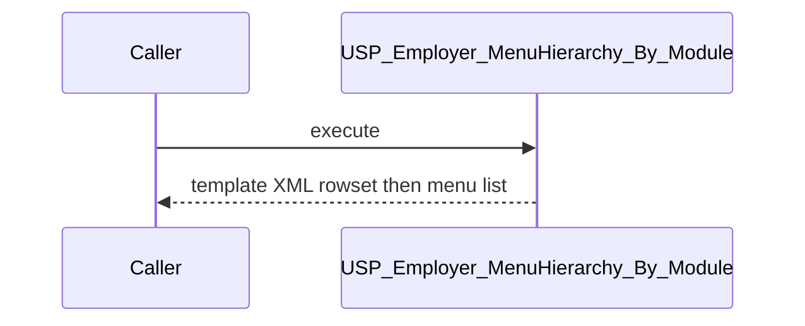
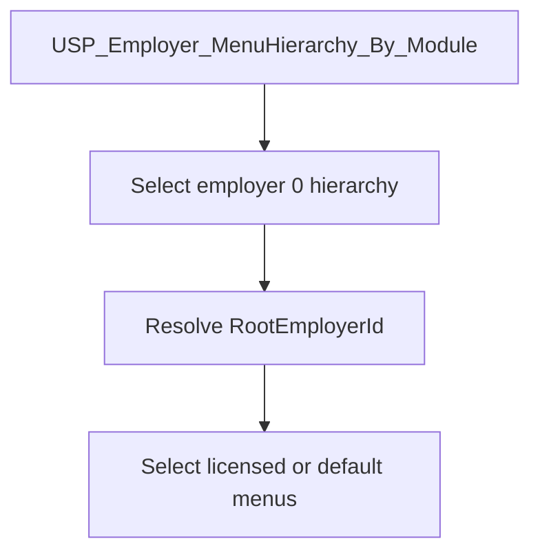

# USP_Employer_MenuHierarchy_By_Module

## What it does

Returns two result sets used after a licence save to rebuild dynamic menu XML. First set is the employer-0 `TDynamicMenuHierarchy` template. Second set lists distinct menus from employer-0 `tMenuDetails` that are default-mapped or mapped to modules active on the employer's root `TEmployerModule` rows.

## Parameters

| Name | Direction | What it is for |
|---|---|---|
| `@EmployerId` | in | Employer whose root licensed modules drive the menu filter |

## Call sequence

## Callers

No other procedure calls this object. `LicenseDetailsDAL.GenerateDynamicMenuBasedOnOptedModules` runs it from `UpdateHRMSLicense` after `USP_TLicence_SaveUpdate`.

## Nested

None.

## Steps

1. Select all `TDynamicMenuHierarchy` rows where `Employerid = 0`.
2. Resolve `@RootEmployerId` from `TEmployerDetails` for `@EmployerId`.
3. Select distinct menus from employer-0 `tMenuDetails` joined to `TModuleMenuMapping` / `THrmsModules` where the mapping is default or the module is active on the root's `TEmployerModule`.

## Tables

| Table | Read or write |
|---|---|
| `dbo.TDynamicMenuHierarchy` | read |
| `dbo.TEmployerDetails` | read |
| `dbo.tMenuDetails` | read |
| `dbo.TModuleMenuMapping` | read |
| `dbo.THrmsModules` | read |
| `dbo.TEmployerModule` | read |

## Unresolved calls

None.

## Flow

