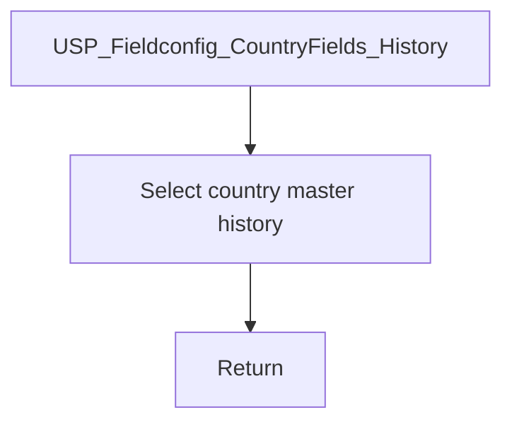

# USP_Fieldconfig_CountryFields_History

## What it does

Returns master update-history rows for one country field name within a section/country, including display text, mask, validation, action, and modifier.

## Parameters

| Name | Direction | What it is for |
|---|---|---|
| `@CountryId` | in | Country id |
| `@SectionId` | in | Section id |
| `@FieldName` | in | Existing field name |

## Call sequence

Calls no other procedures or functions.

## Callers

No other procedure or function in HRMS calls this object as a nested procedure. Application caller: Employee Information Configuration (Core WebAPI FieldConfiguration / preonboarding).

## Nested

Calls no other procedures or functions.

## Steps

1. Script is `HRMS-DATABASE/HRMS/STOREPROCEDURE/USP_Fieldconfig_CountryFields_History.sql`.
2. Select distinct rows from TEmployeeDetail_Fields_MasterUpdateHistory where Fieldentity = Country and keys match.
3. Resolve country and section names; order by Modified_date desc.

## Tables

| Table | Read or write |
|---|---|
| `TEmployeeDetail_Fields_MasterUpdateHistory` | read |
| `Tcountry` | read |
| `Temployeedetail_section` | read |

## Unresolved calls

None.

## Flow

