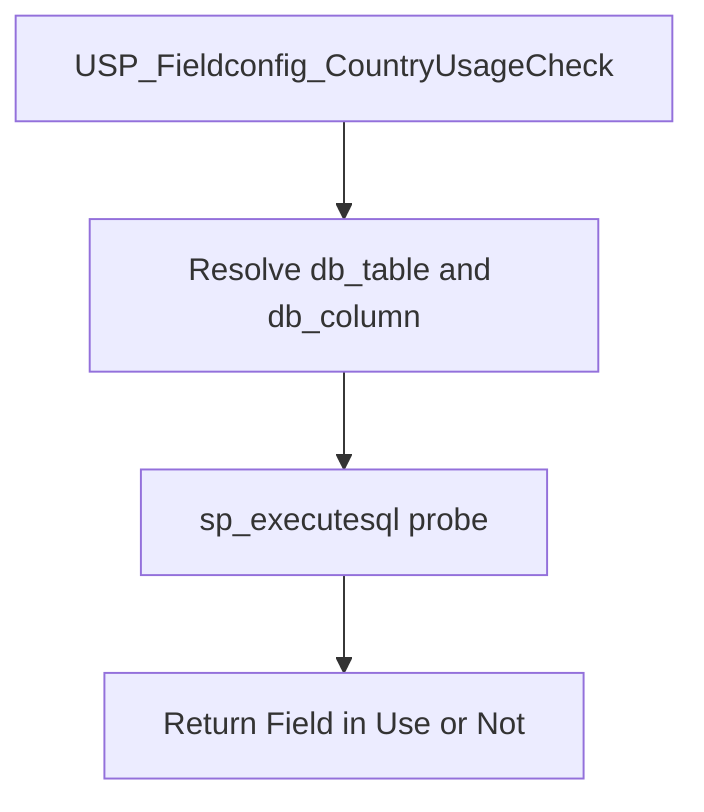

# USP_Fieldconfig_CountryUsageCheck

## What it does

Checks whether a country-specific field already holds employee data. Resolves db_table/db_column from TEmployeeDetail_Fields and runs dynamic SQL via sp_executesql; returns Field in Use or Field Not in Use.

## Parameters

| Name | Direction | What it is for |
|---|---|---|
| `@Fieldname` | in | Country field name |
| `@Countryid` | in | Country id |

## Call sequence

Calls system `sp_executesql` with dynamically built SQL against the field mapped table. Calls no other HRMS procedure.

## Callers

No other procedure or function in HRMS calls this object as a nested procedure. Application caller: Employee Information Configuration (Core WebAPI FieldConfiguration / preonboarding).

## Nested

Calls system `sp_executesql` with dynamically built SQL against the field mapped table. Calls no other HRMS procedure.

## Steps

1. Script is `HRMS-DATABASE/HRMS/STOREPROCEDURE/USP_Fieldconfig_CountryUsageCheck.sql`.
2. Select top 1 db_table and db_column from temployeedetail_fields for Fieldentity = Country.
3. Build SELECT probing non-empty column values for employees with matching CountryofEmployment.
4. EXEC sp_executesql; return Field in Use if any row, else Field Not in Use.

## Tables

| Table | Read or write |
|---|---|
| `temployeedetail_fields` | read |
| `temployee` | read |
| `(dynamic db_table from field mapping)` | read |

## Unresolved calls

None.

## Flow

