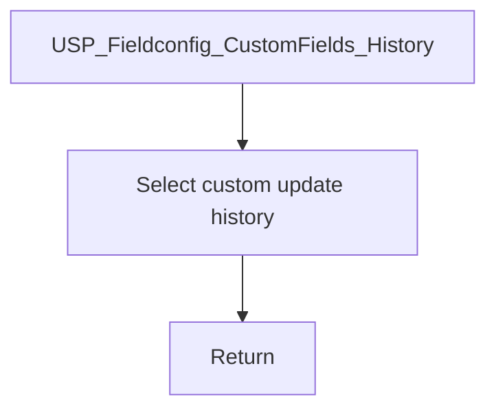

# USP_Fieldconfig_CustomFields_History

## What it does

Returns update-history rows for one custom field (employer, section, field), including action, validation/status, control values, and modifier name.

## Parameters

| Name | Direction | What it is for |
|---|---|---|
| `@EmployerID` | in | Employer id |
| `@SectionId` | in | Section id |
| `@FieldID` | in | Field id |

## Call sequence

Calls no other procedures or functions.

## Callers

No other procedure or function in HRMS calls this object as a nested procedure. Application caller: Employee Information Configuration (Core WebAPI FieldConfiguration / preonboarding).

## Nested

Calls no other procedures or functions.

## Steps

1. Script is `HRMS-DATABASE/HRMS/STOREPROCEDURE/USP_Fieldconfig_CustomFields_History.sql`.
2. Select from TEmployeeDetail_Fields_UpdateHistory where Fieldentity = Custom and keys match.
3. Resolve section name and ModifiedBy from Temployeedetail_section / Temployee; order by Modified_date desc.

## Tables

| Table | Read or write |
|---|---|
| `TEmployeeDetail_Fields_UpdateHistory` | read |
| `Temployeedetail_section` | read |
| `Temployee` | read |

## Unresolved calls

None.

## Flow

