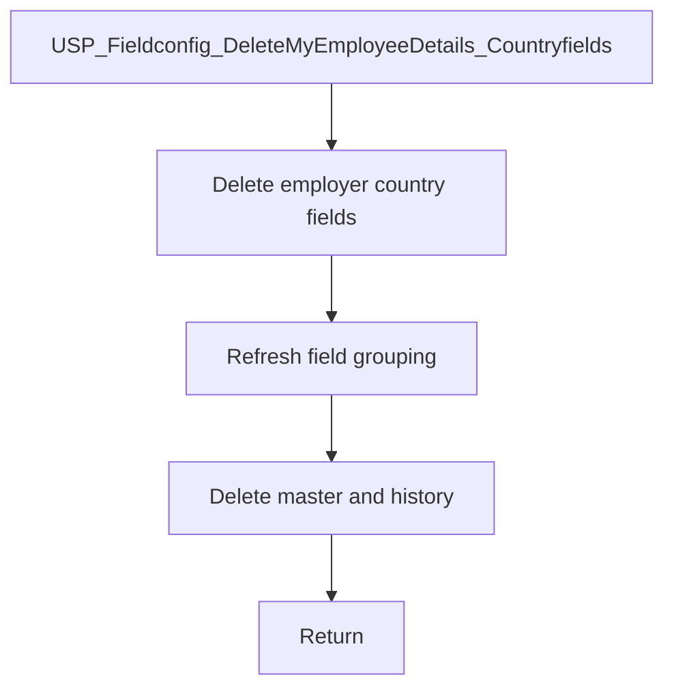

# USP_Fieldconfig_DeleteMyEmployeeDetails_Countryfields

## What it does

Deletes country-specific field definitions from employer fields and master, cleans master update history for the selected rows, and refreshes related FieldsGroup / Fieldids grouping metadata for personal and current-employment sections.

## Parameters

| Name | Direction | What it is for |
|---|---|---|
| `@SectionFields` | in | JSON identifying country field(s) to delete |
| `@UpdatedBy` | in | Employee id of the deleter |

## Call sequence

Calls no other procedures or functions.

## Callers

No other procedure or function in HRMS calls this object as a nested procedure. Application caller: Employee Information Configuration (Core WebAPI FieldConfiguration / preonboarding).

## Nested

Calls no other procedures or functions.

## Steps

1. Script is `HRMS-DATABASE/HRMS/STOREPROCEDURE/USP_Fieldconfig_DeleteMyEmployeeDetails_Countryfields.sql`.
2. Begin transaction; delete matching TEmployeeDetail_Fields rows linked to country master.
3. Refresh FieldsGroup/Fieldids from TEmployeeDetail_Fields_Grouping for personal/current employment sections.
4. Delete matching TEmployeeDetail_Fields_Master and TEmployeeDetail_Fields_MasterUpdateHistory rows; commit or roll back.

## Tables

| Table | Read or write |
|---|---|
| `TEmployeeDetail_Fields` | read and write |
| `TEmployeeDetail_Fields_master` | read and write |
| `TEmployeeDetail_Fields_MasterUpdateHistory` | write |
| `TemployeeDetail_Fields_Grouping` | read |
| `Temployeedetail_Section` | read |

## Unresolved calls

None.

## Flow

