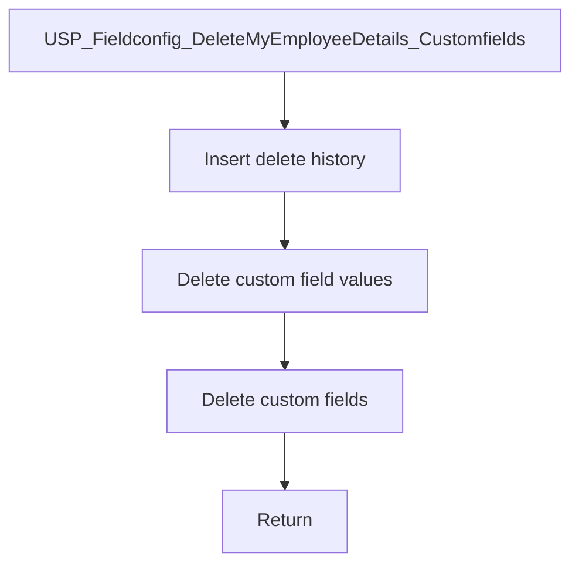

# USP_Fieldconfig_DeleteMyEmployeeDetails_Customfields

## What it does

Hard-deletes selected custom fields: logs delete history, removes TEmployeedetailCustomFieldValues, then deletes matching TEmployeeDetail_Fields rows where FieldEntity = Custom.

## Parameters

| Name | Direction | What it is for |
|---|---|---|
| `@SectionFields` | in | JSON array with EMPLOYERID, SECTIONID, FIELDID |
| `@UpdatedBy` | in | Employee id of the deleter |

## Call sequence

Calls no other procedures or functions.

## Callers

No other procedure or function in HRMS calls this object as a nested procedure. Application caller: Employee Information Configuration (Core WebAPI FieldConfiguration / preonboarding).

## Nested

Calls no other procedures or functions.

## Steps

1. Script is `HRMS-DATABASE/HRMS/STOREPROCEDURE/USP_Fieldconfig_DeleteMyEmployeeDetails_Customfields.sql`.
2. Begin transaction; insert TEmployeeDetail_Fields_deletehistory for matched custom fields.
3. Delete TEmployeedetailCustomFieldValues for those FieldIDs.
4. Delete TEmployeeDetail_Fields custom rows; commit or roll back.

## Tables

| Table | Read or write |
|---|---|
| `TEmployeeDetail_Fields` | read and write |
| `TEmployeeDetail_Fields_deletehistory` | write |
| `TEmployeedetailCustomFieldValues` | write |

## Unresolved calls

None.

## Flow

