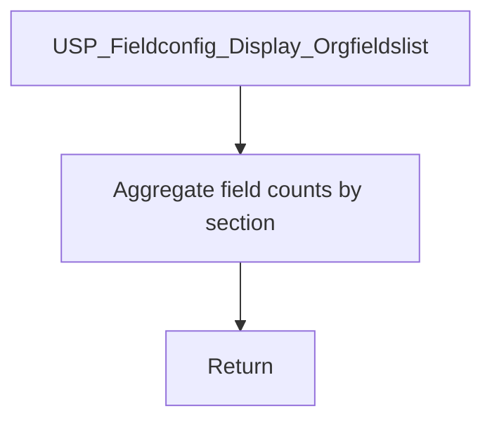

# USP_Fieldconfig_Display_Orgfieldslist

## What it does

Builds the Employee Field Configuration grid for one employer: per-section counts of total, mandatory, and non-mandatory active fields (System, Country, and custom), excluding internal id-only field names and limiting CountryId to the employer country or 0.

## Parameters

| Name | Direction | What it is for |
|---|---|---|
| `@Employerid` | in | Employer id (default 0) |

## Call sequence

Calls no other procedures or functions.

## Callers

No other procedure or function in HRMS calls this object as a nested procedure. Application caller: Employee Information Configuration (Core WebAPI FieldConfiguration / preonboarding).

## Nested

Calls no other procedures or functions.

## Steps

1. Script is `HRMS-DATABASE/HRMS/STOREPROCEDURE/USP_Fieldconfig_Display_Orgfieldslist.sql`.
2. Join TEmployeeDetail_Fields to TEmployerDetails and TEmployeeDetail_Section.
3. Filter FieldEntity in System/Country/custom, IsActive=1, IsDeleted=0, CountryId in (employer country, 0), exclude listed surrogate FieldNames.
4. Group by employer and section; count total, mandatory, and non-mandatory fields.

## Tables

| Table | Read or write |
|---|---|
| `TEmployeeDetail_Fields` | read |
| `temployerdetails` | read |
| `TEmployeeDetail_Section` | read |

## Unresolved calls

None.

## Flow

