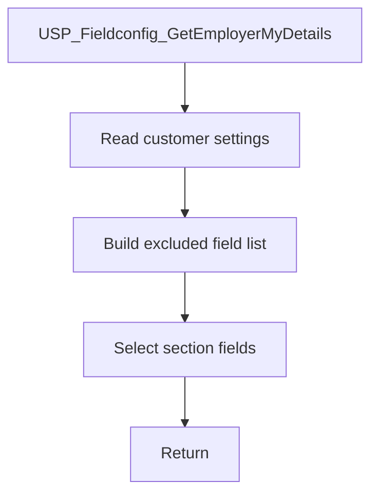

# USP_Fieldconfig_GetEmployerMyDetails

## What it does

Loads editable field metadata for one or more section ids on an employer. Applies customer settings (shift roster / cost center) to exclude ShiftGroup or CostCenter when disabled, and always excludes attachment/id surrogate fields and Profile Picture.

## Parameters

| Name | Direction | What it is for |
|---|---|---|
| `@Sectionid` | in | Comma-separated section ids |
| `@EmployerId` | in | Employer id |

## Call sequence

Calls no other procedures or functions.

## Callers

No other procedure or function in HRMS calls this object as a nested procedure. Application caller: Employee Information Configuration (Core WebAPI FieldConfiguration / preonboarding).

## Nested

Calls no other procedures or functions.

## Steps

1. Script is `HRMS-DATABASE/HRMS/STOREPROCEDURE/USP_Fieldconfig_GetEmployerMyDetails.sql`.
2. Read IsShowShiftRoaster and IsCostCenterEnabled from TCustomerSettings.
3. Build #ExcludedFields for Document Details AttachmentId, listed surrogate ids, and conditional ShiftGroup/CostCenter.
4. Select System/Country/custom active fields for the employer and section list into #EmployeeFields, excluding profile picture and excluded ids.
5. Return #EmployeeFields ordered by SectionID, CountryName, DisplayText.

## Tables

| Table | Read or write |
|---|---|
| `TCustomerSettings` | read |
| `TEmployeeDetail_Section` | read |
| `TEmployeeDetail_Fields` | read |
| `TEmployerDetails` | read |
| `Tcountry` | read |
| `temployee` | read |

## Unresolved calls

None.

## Flow

