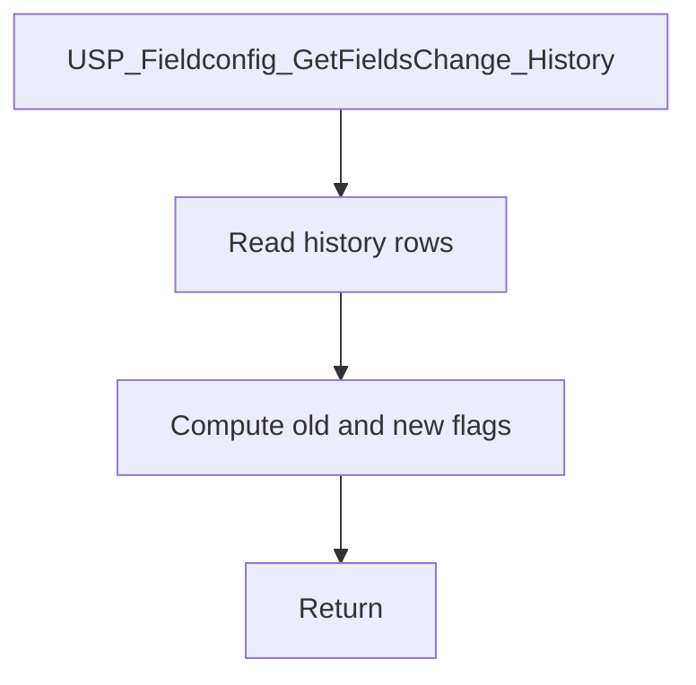

# USP_Fieldconfig_GetFieldsChange_History

## What it does

Returns field-configuration history for one employer section, projecting old/new mandatory, hidden, and public values using LAG against TEmployeeDetail_FieldsConfigHistory joined to current TEmployeeDetail_Fields.

## Parameters

| Name | Direction | What it is for |
|---|---|---|
| `@Employerid` | in | Employer id |
| `@SectionId` | in | Section id |

## Call sequence

Calls no other procedures or functions.

## Callers

No other procedure or function in HRMS calls this object as a nested procedure. Application caller: Employee Information Configuration (Core WebAPI FieldConfiguration / preonboarding).

## Nested

Calls no other procedures or functions.

## Steps

1. Script is `HRMS-DATABASE/HRMS/STOREPROCEDURE/USP_Fieldconfig_GetFieldsChange_History.sql`.
2. Select history rows for employer/section.
3. Compute old/new mandatory, hidden, and public via LAG partitioned by FieldName.
4. Resolve ModifiedBy name from Temployee; order by Modifieddate desc.

## Tables

| Table | Read or write |
|---|---|
| `TEmployeeDetail_FieldsConfigHistory` | read |
| `TEmployeeDetail_Fields` | read |
| `Temployee` | read |

## Unresolved calls

None.

## Flow

