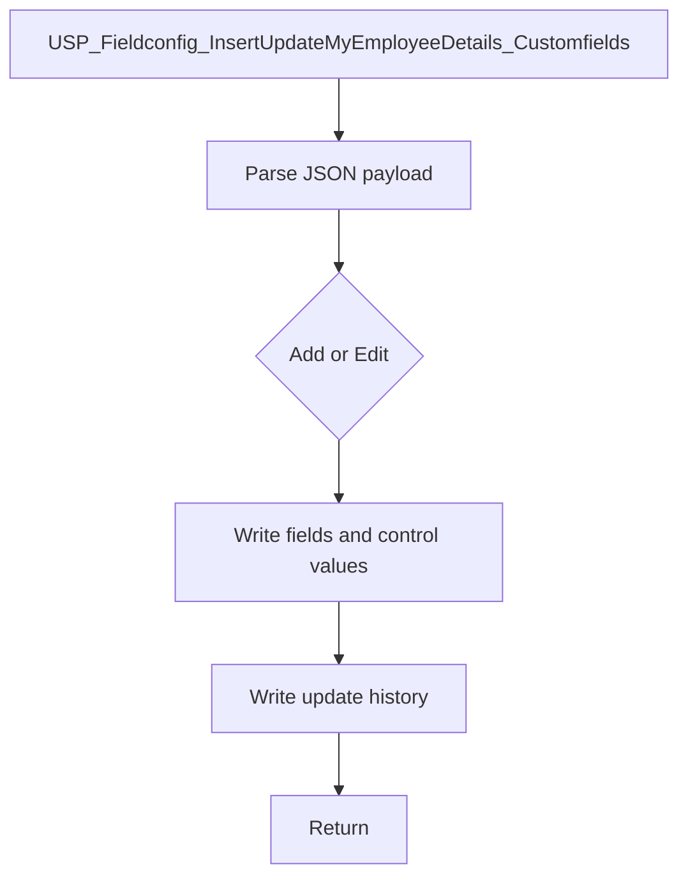

# USP_Fieldconfig_InsertUpdateMyEmployeeDetails_Customfields

## What it does

Inserts or updates employer custom fields from JSON (display name, control type, values, length, format, status, date bounds). Writes update history and maintains TEmployeedetailCustomFieldValues for dropdown/radio/checkbox values.

## Parameters

| Name | Direction | What it is for |
|---|---|---|
| `@SectionFields` | in | JSON custom-field payload including ACTION Add or Edit |
| `@UpdatedBy` | in | Employee id of the saver |

## Call sequence

Calls no other procedures or functions.

## Callers

No other procedure or function in HRMS calls this object as a nested procedure. Application caller: Employee Information Configuration (Core WebAPI FieldConfiguration / preonboarding).

## Nested

Calls no other procedures or functions.

## Steps

1. Script is `HRMS-DATABASE/HRMS/STOREPROCEDURE/USP_Fieldconfig_InsertUpdateMyEmployeeDetails_Customfields.sql`.
2. OPENJSON @SectionFields into local variables (employer, section, control type, dates, action).
3. Branch on ACTION / existence of FieldID to insert or update TEmployeeDetail_Fields.
4. Sync control values in TEmployeedetailCustomFieldValues when applicable.
5. Insert TEmployeeDetail_Fields_UpdateHistory rows for edits; return success/failure result set.

## Tables

| Table | Read or write |
|---|---|
| `TEmployeeDetail_Fields` | read and write |
| `TEmployeedetailCustomFieldValues` | read and write |
| `TEmployeeDetail_Fields_UpdateHistory` | write |
| `TFieldType_LOOKUP` | read |
| `TEmployeeDetail_Section` | read |

## Unresolved calls

None.

## Flow

