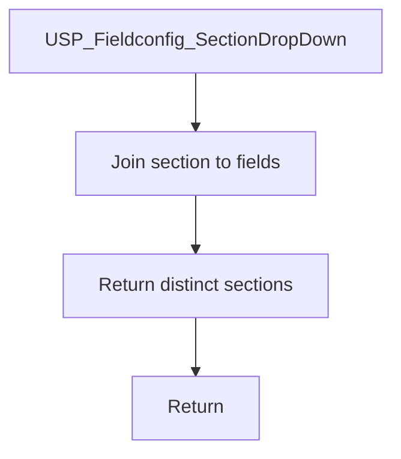

# USP_Fieldconfig_SectionDropDown

## What it does

Returns distinct active/inactive employee-detail sections that already have at least one field row for the employer, ordered by SectionId.

## Parameters

| Name | Direction | What it is for |
|---|---|---|
| `@EmployerId` | in | Employer whose sections to list |

## Call sequence

Calls no other procedures or functions.

## Callers

No other procedure or function in HRMS calls this object as a nested procedure. Application caller: Employee Information Configuration (Core WebAPI FieldConfiguration / preonboarding).

## Nested

Calls no other procedures or functions.

## Steps

1. Script is `HRMS-DATABASE/HRMS/STOREPROCEDURE/USP_Fieldconfig_SectionDropDown.sql`.
2. Select distinct Section, SectionId, and IsActive text from TEmployeeDetail_Section joined to TEmployeeDetail_Fields where EmployerId = @EmployerId.
3. Order by SectionId ascending.

## Tables

| Table | Read or write |
|---|---|
| `TEmployeeDetail_Section` | read |
| `TEmployeeDetail_Fields` | read |

## Unresolved calls

None.

## Flow

