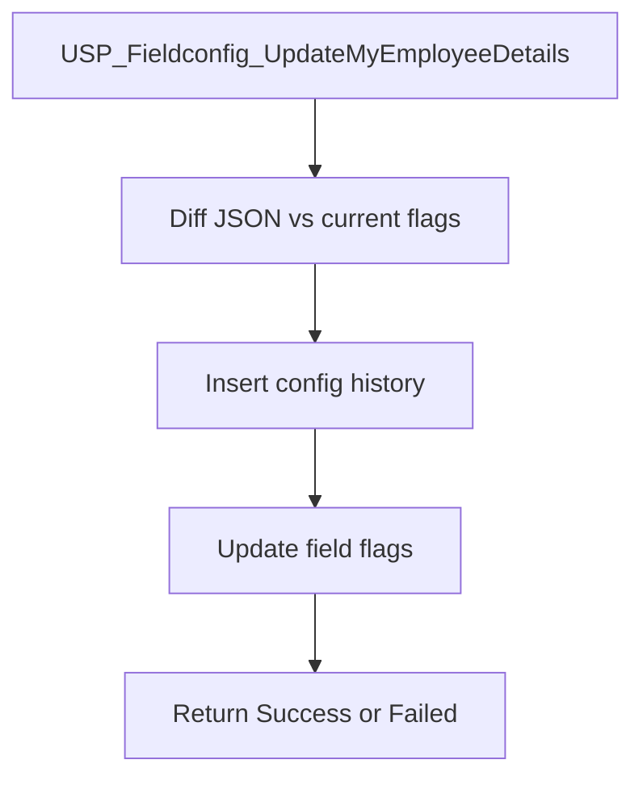

# USP_Fieldconfig_UpdateMyEmployeeDetails

## What it does

Applies administrator changes to IsMandatory, IsHidden, and IsPublic on TEmployeeDetail_Fields from a JSON array. Writes a history row for each changed field, then updates the live field row inside a transaction.

## Parameters

| Name | Direction | What it is for |
|---|---|---|
| `@SectionFields` | in | JSON array of field rows with Employerid, SectionID, FieldID, IsMandatory, IsHidden, IsPublic |
| `@UpdatedBy` | in | Employee id of the saver |

## Call sequence

Calls no other procedures or functions.

## Callers

No other procedure or function in HRMS calls this object as a nested procedure. Application caller: Employee Information Configuration (Core WebAPI FieldConfiguration / preonboarding).

## Nested

Calls no other procedures or functions.

## Steps

1. Script is `HRMS-DATABASE/HRMS/STOREPROCEDURE/USP_Fieldconfig_UpdateMyEmployeeDetails.sql`.
2. Begin transaction UPDATE_EMPLOYEE_DATA.
3. OPENJSON @SectionFields and find rows whose mandatory/hidden/public flags differ; stage into #TEmployeeDetail_FieldsConfigHistory.
4. Insert matching current values into TEmployeeDetail_FieldsConfigHistory.
5. Update TEmployeeDetail_Fields IsMandatory, IsHidden, IsPublic, UpdatedBy, Updateddate for changed rows.
6. Commit and return Success; on error roll back, log TSQL_ERRORLOGS, return Failed.

## Tables

| Table | Read or write |
|---|---|
| `TEmployeeDetail_Fields` | read and write |
| `TEmployeeDetail_FieldsConfigHistory` | write |
| `TSQL_ERRORLOGS` | write |

## Unresolved calls

None.

## Flow

