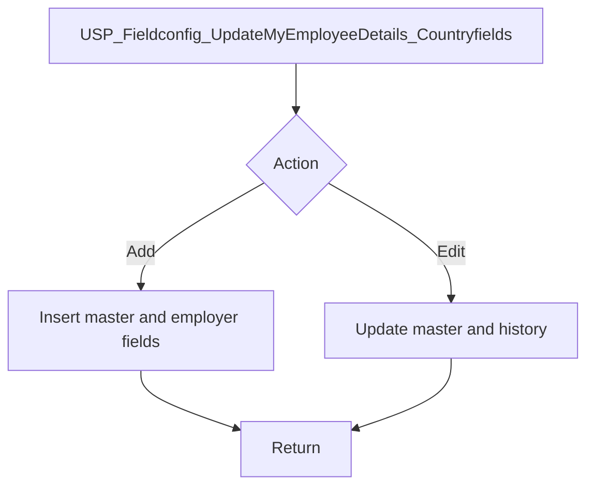

# USP_Fieldconfig_UpdateMyEmployeeDetails_Countryfields

## What it does

Adds or edits country-specific field definitions. Action Add inserts into TEmployeeDetail_Fields_Master and related employer field rows; Action Edit updates display/mask/validation and writes master update history.

## Parameters

| Name | Direction | What it is for |
|---|---|---|
| `@SectionFields` | in | JSON country-field payload |
| `@Action` | in | Add or Edit |
| `@UpdatedBy` | in | Employee id of the saver |

## Call sequence

Calls no other procedures or functions.

## Callers

No other procedure or function in HRMS calls this object as a nested procedure. Application caller: Employee Information Configuration (Core WebAPI FieldConfiguration / preonboarding).

## Nested

Calls no other procedures or functions.

## Steps

1. Script is `HRMS-DATABASE/HRMS/STOREPROCEDURE/USP_Fieldconfig_UpdateMyEmployeeDetails_Countryfields.sql`.
2. Parse JSON into local variables.
3. When Action = Add and the master row does not already exist, insert master and employer field copies.
4. When Action = Edit, update master/employer field attributes and insert TEmployeeDetail_Fields_MasterUpdateHistory.
5. Return success/failure result.

## Tables

| Table | Read or write |
|---|---|
| `TEmployeeDetail_Fields_Master` | read and write |
| `TEmployeeDetail_Fields` | read and write |
| `TEmployeeDetail_Fields_MasterUpdateHistory` | write |
| `TEmployeeDetail_Section` | read |

## Unresolved calls

None.

## Flow

