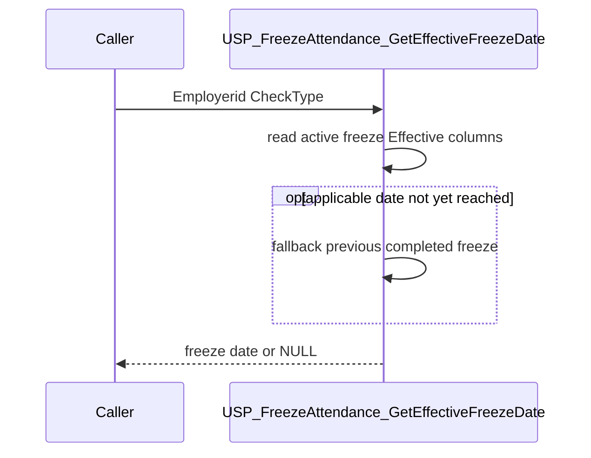
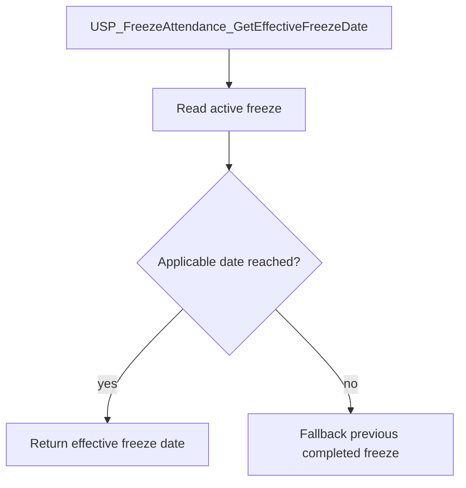

# USP_FreezeAttendance_GetEffectiveFreezeDate

## What it does

Returns the currently enforced attendance freeze date for an employer for employee (`E`) or approver (`A`) checks. Uses the active freeze’s effective columns, with fallback to the previous completed freeze when the new applicable date has not yet arrived.

## Parameters

| Name | Direction | What it is for |
|---|---|---|
| `@Employerid` | in | Employer |
| `@CheckType` | in | `E` employee / `A` approver |

## Call sequence

## Callers

Used by leave validation (`USP_LA_ValidateLeaveRequest`) and other L&A freeze gates.

## Nested

Calls no other procedures or functions beyond table reads.

## Steps

1. Read active freeze row for employer.
2. If applicable date for `@CheckType` has not arrived, fall back to previous completed freeze with WentInactiveDate guard.
3. Return freeze date or NULL when never frozen.

## Tables

| Table | Read or write |
|---|---|
| Freeze attendance tables (`TFreezeAttendance` / related) | read |

## Unresolved calls

None.

## Flow

