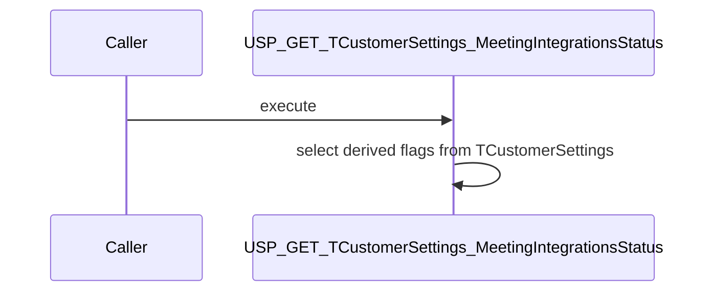
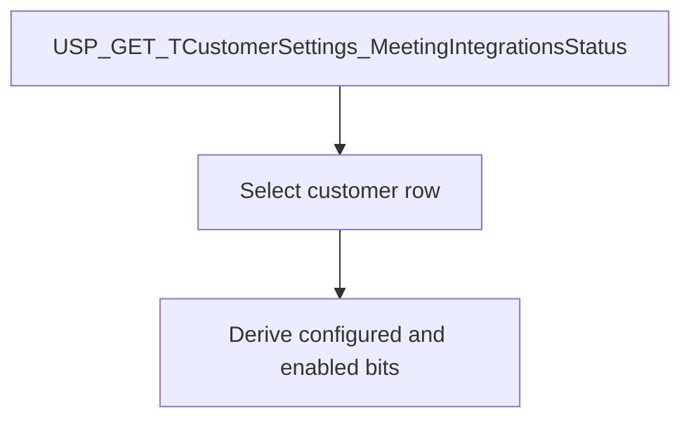

# USP_GET_TCustomerSettings_MeetingIntegrationsStatus

## What it does

Returns whether Teams, Zoom, Google, and LMS Teams meeting credentials are configured and enabled for one customer, plus verification and expiry timestamps. Customer Config uses it for the Meeting Integrations UI and as a gate before saving LMS with Teams attendance enabled.

## Parameters

| Name | Direction | What it is for |
|---|---|---|
| `@CustomerId` | in | Customer number |

## Call sequence

Calls no other procedures or functions.

## Callers

No other procedure or function calls this object. `UpdateSetupCustomerSetting` and meeting-integration handlers execute it from Customer Config.

## Nested

Calls no other procedures or functions.

## Steps

1. In `HRMS-DATABASE/HRMS/STOREPROCEDURE/USP_GET_TCustomerSettings_MeetingIntegrationsStatus.sql`, select the top `TCustomerSettings` row for `@CustomerId`.
2. Derive configured / enabled bits from non-empty credential columns and enabled flags.
3. Return verification and secret-expiry timestamps.

## Tables

| Table | Read or write |
|---|---|
| `dbo.TCustomerSettings` | read |

## Flow

