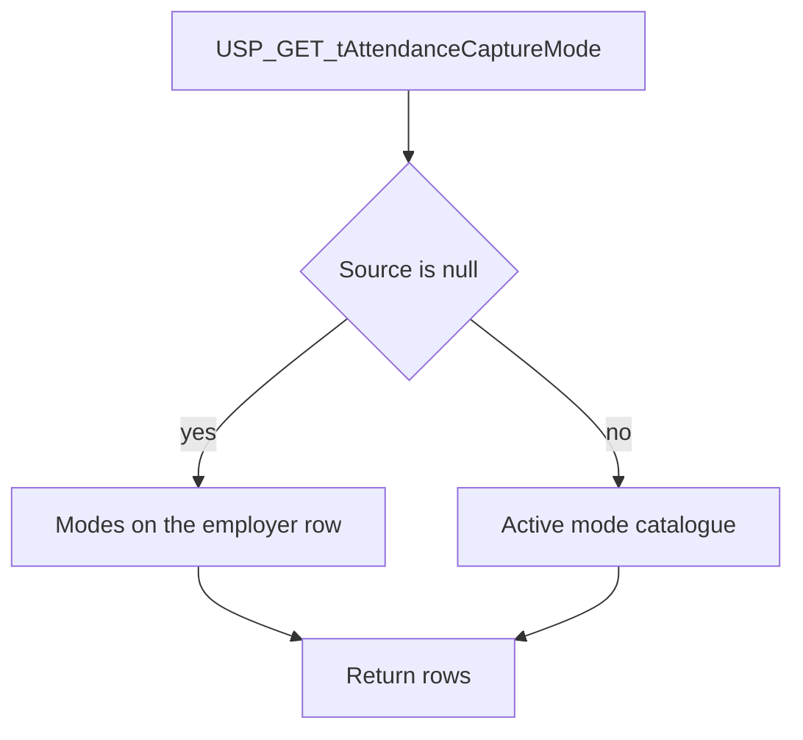

# USP_GET_tAttendanceCaptureMode

## What it does

Returns attendance capture modes. Add Organization passes Source Organization, so it takes the branch that lists every active mode row for the employer, not only the modes already stored on the employer.

## Parameters

| Name | Direction | What it is for |
|---|---|---|
| `@EmployerID` | in | Employer. Default null |
| `@Source` | in | Null lists modes currently on the employer. Any other value lists active catalogue rows. Default null |

## Call sequence

Calls no other procedures or functions.

## Callers

Procedures and functions that call this object.

No other procedure or function calls this object.

## Nested

Calls no other procedures or functions.

## Steps

1. When @Source is null, split TEmployerDetails.AttendanceCaptureType and join active tAttendanceCaptureMode rows for @EmployerID.

2. Otherwise select AttendanceCaptureModeID, AttendanceType, and TypeDescription from active tAttendanceCaptureMode for @EmployerID.

## Tables

| Table | Read or write |
|---|---|
| `TEmployerDetails` | read |
| `tAttendanceCaptureMode` | read |

## Flow

