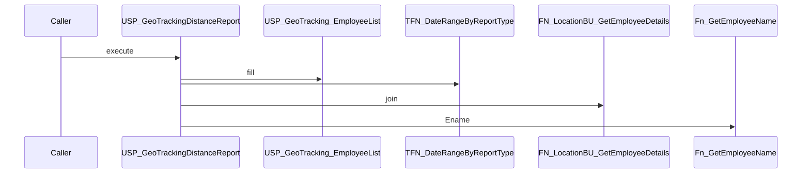
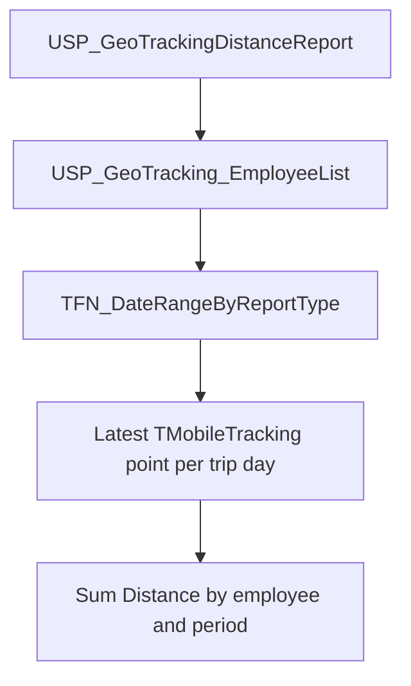

# USP_GeoTrackingDistanceReport

## What it does

Aggregates traveled distance from `TMobileTracking` for the Distance Traveled Report tab. It loads the login user's employee scope via `USP_GeoTracking_EmployeeList`, builds a date-grouping set from `TFN_DateRangeByReportType`, keeps the latest point per trip per day (`rn = 1`), filters by optional employee and business-unit lists, and returns distance in KM and meters grouped by employee and report period.

## Parameters

| Name | Direction | What it is for |
|---|---|---|
| `@StartDate` | in | Report range start |
| `@EndDate` | in | Report range end |
| `@EmployerID` | in | Employer filter |
| `@LoginEmployeeId` | in | Login employee for scope |
| `@BusinessUnitIds` | in | Optional comma-separated BUs |
| `@EmployeeIds` | in | Optional comma-separated employees |
| `@ReportType` | in | Passed to `TFN_DateRangeByReportType` for period buckets |

## Call sequence

## Callers

No other procedure or function calls this object. `GeoTrackingDAL.GeoTrackingDistanceReport` executes it.

## Nested

| Object | Kind | When | Page |
|---|---|---|---|
| `USP_GeoTracking_EmployeeList` | procedure | fill `#Employees` | [USP_GeoTracking_EmployeeList](/docs/database/hrms/USP_GeoTracking_EmployeeList) |
| `TFN_DateRangeByReportType` | function | build `#DateRange` | No page yet (synonym to TIMEPORT only) |
| `FN_LocationBU_GetEmployeeDetails` | function | join | [FN_LocationBU_GetEmployeeDetails](/docs/database/hrms/FN_LocationBU_GetEmployeeDetails) |
| `Fn_GetEmployeeName` | function | select Ename | [Fn_GetEmployeeName](/docs/database/hrms/Fn_GetEmployeeName) |

## Steps

1. In `HRMS-DATABASE/HRMS/STOREPROCEDURE/USP_GeoTrackingDistanceReport.sql`, fill `#Employees` from `USP_GeoTracking_EmployeeList`.
2. Populate `#DateRange` from `TFN_DateRangeByReportType(@ReportType, @StartDate, @EndDate, NULL, NULL)`.
3. CTE `LatestRecords` reads `TMobileTracking` for scoped active employees, employer, optional employee/BU filters, and date range; ranks by trip and day.
4. Select rows with `rn = 1`, join `#DateRange`, sum `Distance` into KM and meters. Order by employee and period start.

## Tables

| Table | Read or write |
|---|---|
| `dbo.TMobileTracking` | read |
| `dbo.TEmployee` | read |
| `dbo.TEmployeeInfo` | read |
| `dbo.TEmployerDetails` | read |
| `dbo.TOrgHierarchyDetails` | read |

## Unresolved calls

`TFN_DateRangeByReportType` is referenced as `dbo.TFN_DateRangeByReportType`. In this repo only a synonym script under `DML/72154/` points at `HRM_CL_TIMEPORT`. The function body was not read here.

## Flow

