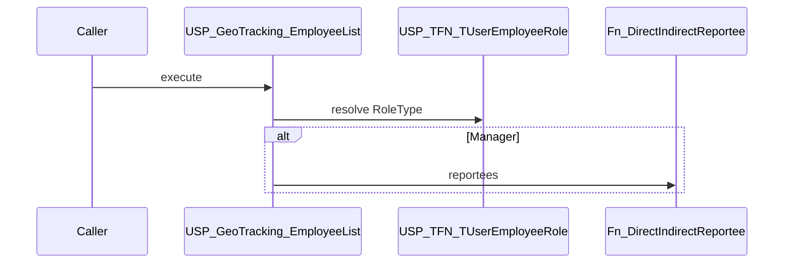
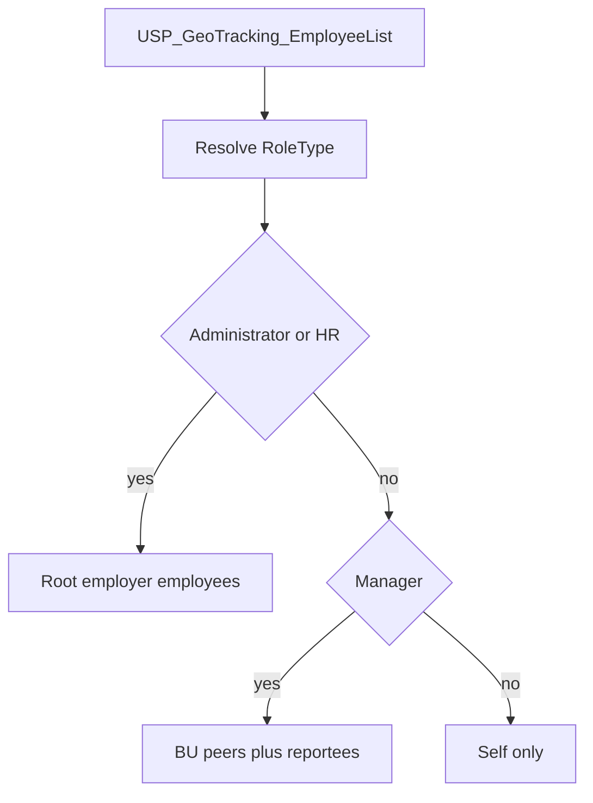

# USP_GeoTracking_EmployeeList

## What it does

Returns employee ids visible to the caller based on role type from `USP_TFN_TUserEmployeeRole`. Administrator/HR get all employees under the root employer. Manager get same business-unit employees unioned with direct/indirect reportees. Employee role returns only self.

## Parameters

| Name | Direction | What it is for |
|---|---|---|
| `@EmployeeId` | in | Operator whose role drives the list |

## Call sequence

## Callers

| Object | Kind | Page |
|---|---|---|
| `SP_BGV_GetAllActiveEmployee` | procedure | [SP_BGV_GetAllActiveEmployee](/docs/database/hrms/SP_BGV_GetAllActiveEmployee) |
| `USP_GeoTrackingDistanceReport` | procedure | No page yet |
| `USP_AdminWM_GetBusinessUnitByOrg_EmployeeId` | procedure | No page yet |
| `SP_GetEmployeeListByOrgAndBU` | procedure | No page yet |

## Nested

| Object | Kind | When | Page |
|---|---|---|---|
| `USP_TFN_TUserEmployeeRole` | function | always | [USP_TFN_TUserEmployeeRole](/docs/database/hrms/USP_TFN_TUserEmployeeRole) |
| `Fn_DirectIndirectReportee` | function | Manager branch | [Fn_DirectIndirectReportee](/docs/database/hrms/Fn_DirectIndirectReportee) |

## Steps

1. Script is `HRMS-DATABASE/HRMS/STOREPROCEDURE/USP_GeoTracking_EmployeeList.sql`.
2. Read `@RoleType` from `USP_TFN_TUserEmployeeRole`.
3. Administrator/HR: employees whose employer shares the caller’s `RootEmployerId`.
4. Manager: same `BusinessUnitID` employees union `Fn_DirectIndirectReportee`.
5. Employee: return `@EmployeeId` only.

## Tables

| Table | Read or write |
|---|---|
| `dbo.TEmployee` | read |
| `dbo.TEmployerDetails` | read |
| `dbo.TEmployeeInfo` | read |

## Flow

