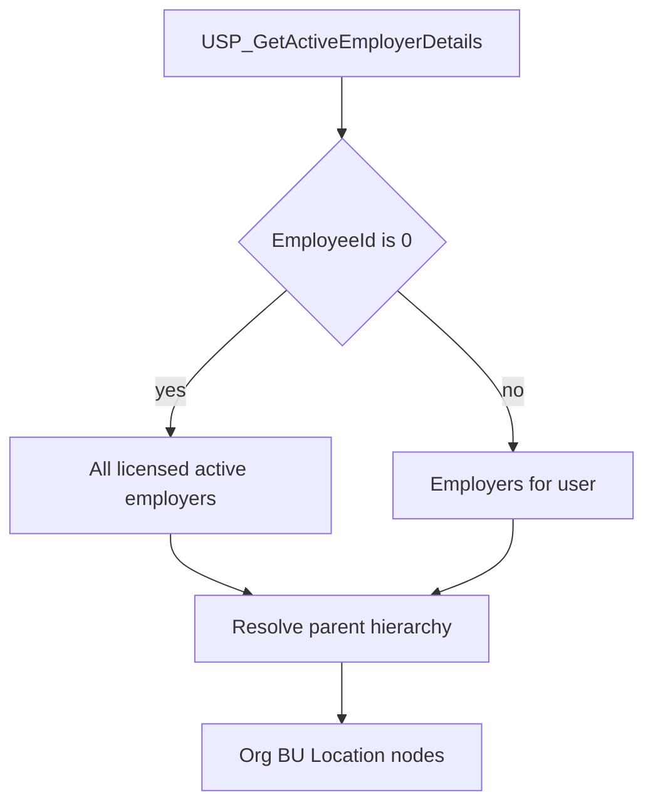

# USP_GetActiveEmployerDetails

## What it does

Builds a flat hierarchy of active, licensed organisations plus their business units and locations for clone/source pickers. `@EmployeeId = 0` (Admin / global path) includes every active employer under an active `TLicence` and also emits the DefaultEmployer (`EmployerId = 0`) org node. A non-zero employee id restricts the base set to employers that user can reach via `tUsers` / `TUserEmployee`.

## Parameters

| Name | Direction | What it is for |
|---|---|---|
| `@EmployeeId` | in | `0` = all licensed active orgs; otherwise scope by user |

## Call sequence

Calls no other procedures or functions.

## Callers

No other procedure or function calls this object.

`WorkflowDAL.GetActiveEmployerDetails` executes it from `GET /api/workflow/getActiveEmployerDetails` (Workflow Dashboard org tree).

## Nested

Calls no other procedures or functions.

## Steps

1. Load `#BaseEmployers` — either all active non-deleted employers with an active non-soft-deleted `TLicence` on `RootEmployerID`, or the subset reachable by `@EmployeeId`.
2. Resolve effective parents into `#ResolvedEmployers` and expand a recursive hierarchy sort path into `#EmployerHierarchy`.
3. Union final rows: optional DefaultEmployer org when `@EmployeeId = 0`, each employer as `NodeType = Org`, folder and leaf `BU` rows from `TORGHIERARCHYDETAILS`, and folder and leaf `LOC` rows from `TLocation`.
4. Return `EmployerID`, `ID`, `NodeType`, `HierarchyID`, `ParentHierarchyID`, `Label`, `ParentNodeID`, `RootEmployerID`, ordered by `SortPath`.

## Tables

| Table | Read or write |
|---|---|
| `TEmployerDetails` | read |
| `TLicence` | read |
| `tUsers` | read |
| `TUserEmployee` | read |
| `TORGHIERARCHYDETAILS` | read |
| `TLocation` | read |

## Unresolved calls

None.

## Flow

