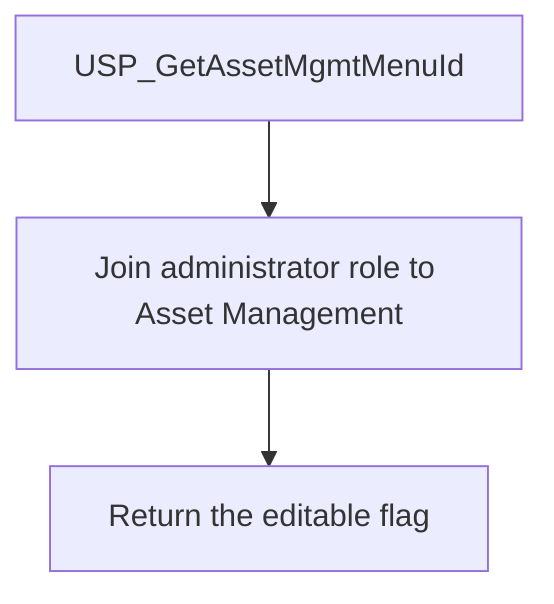

# USP_GetAssetMgmtMenuId

## What it does

Returns whether an administrator role for the employer has the Asset Management menu tab marked editable. The RRS config panel hides the asset column when this result is empty.

## Parameters

| Name | Direction | What it is for |
|---|---|---|
| `@Employerid` | in | Organisation |

## Call sequence

Calls no other procedures or functions.

## Callers

No other procedure or function calls this object.

`recruitmentDAL.GetAssetMgmtMenuId` calls it from the RRS config panel.

## Nested

Calls no other procedures or functions.

## Steps

1. Join `TRoles` to `TRolePagesMapping`, `tMenuDetails`, and `TRoleTabDetails` (`USP_GetAssetMgmtMenuId.sql`).
2. Keep the menu named `Asset Management` that is active, role type `Administrator`, this employer, and `iseditable` = `y`.
3. Return distinct `Employerid` and `iseditable` as `hasAccessMgmtModule`.

## Tables

| Table | Read or write |
|---|---|
| `TRoles` | read |
| `TRolePagesMapping` | read |
| `tMenuDetails` | read |
| `TRoleTabDetails` | read |

## Flow

