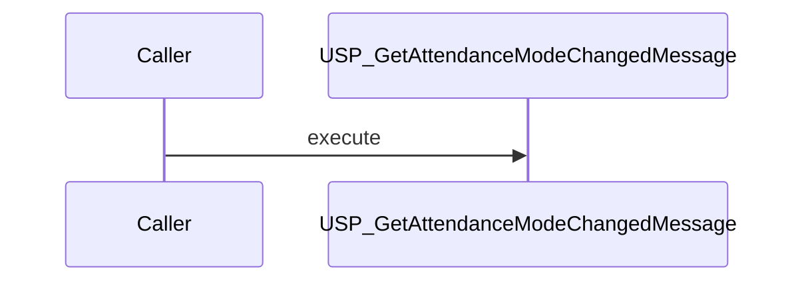
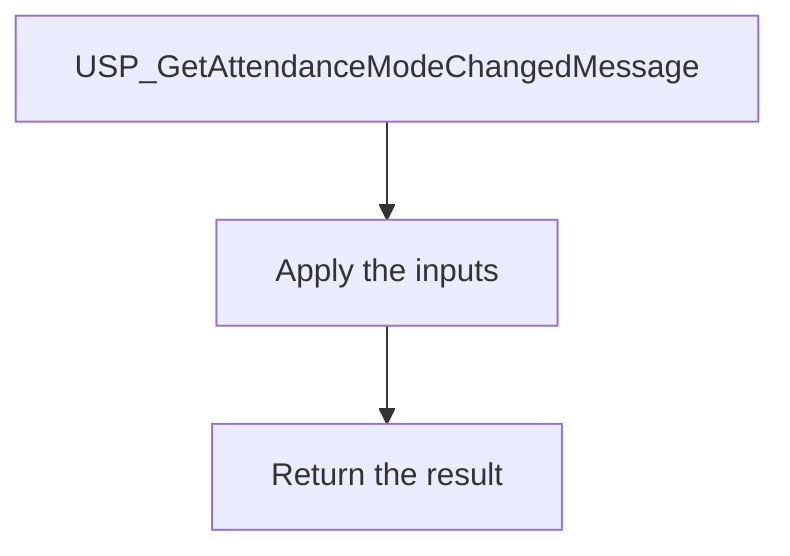

# USP_GetAttendanceModeChangedMessage

## What it does

Returns a sentence when the employee's attendance capture mode effective today differs from the previous history row. The attendance card shows that sentence.

## Parameters

| Name | Direction | What it is for |
|---|---|---|
| `@EmployeeId` | in | Employee the Home screen is loading or acting for (`INT`) |

## Call sequence

## Callers

No other procedure or function under STOREPROCEDURE or FUNCTIONS executes this object.

## Nested

This object does not execute another procedure or user-defined function.

## Steps

In `HRMS-DATABASE/HRMS/STOREPROCEDURE/USP_GetAttendanceModeChangedMessage.sql`:

1. Returns a sentence when the employee's attendance capture mode effective today differs from the previous history row.
2. The attendance card shows that sentence.

## Tables

| Table | Read or write |
|---|---|
| `tEmployeeInfo` | read |
| `TEmployeeInfoHistory` | read |
| `tAttendanceCaptureMode` | read |

## Flow

