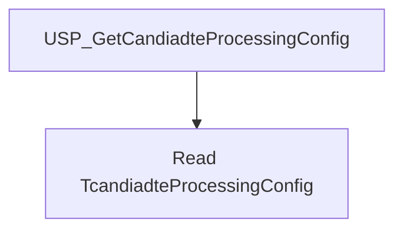

# USP_GetCandiadteProcessingConfig

## What it does

Returns the candidate-processing configuration flags for one employer. Add Template uses these flags to decide which template categories are available.

## Parameters

| Name | Direction | What it is for |
|---|---|---|
| `@Employerid` | in | Employer whose config is read |

## Call sequence

Calls no other procedures or functions.

## Callers

No other procedure or function calls this object.

## Nested

Calls no other procedures or functions.

## Steps

1. Select processing-config id, employer id, candidate-info and offer-acceptance template flags, automatic pre-onboarding link flag, and review-mandatory flag from `TcandiadteProcessingConfig` for `@Employerid`.

## Tables

| Table | Read or write |
|---|---|
| `TcandiadteProcessingConfig` | read |

## Flow

