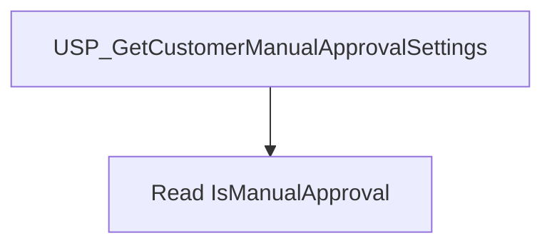

# USP_GetCustomerManualApprovalSettings

## What it does

Returns the distinct manual-approval flag for one employer. The RRS config panel uses it to decide whether approver columns or reporting-manager columns stay on the Excel list.

## Parameters

| Name | Direction | What it is for |
|---|---|---|
| `@EmployerId` | in | Organisation |

## Call sequence

Calls no other procedures or functions.

## Callers

No other procedure or function calls this object.

`recruitmentDAL.GetCustomerManualApprovalSettings` calls it from the RRS config panel.

## Nested

Calls no other procedures or functions.

## Steps

1. Select distinct `Id` and `IsManualApproval` from `TCustomerSettings` for `@EmployerId` (`USP_GetCustomerManualApprovalSettings.sql`).

## Tables

| Table | Read or write |
|---|---|
| `TCustomerSettings` | read |

## Flow

