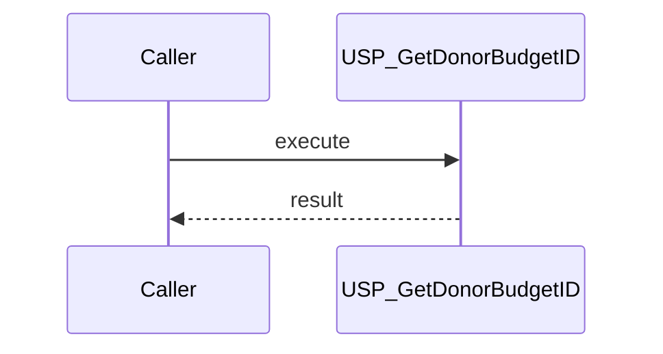
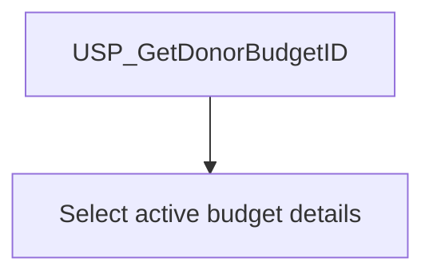

# USP_GetDonorBudgetID

## What it does

Returns active donor budget detail ids for an employer (status active and current date within budget start/end). Used by Expense Report budget-code filter via T&E `EmployeeDAL.GetBudgetCodes` against HRMSCore.

## Parameters

| Name | Direction | What it is for |
|---|---|---|
| `@EmployerID` | in | Employer scope |

## Call sequence

## Callers

| Caller | Page |
|---|---|
| `EmployeeDAL.GetBudgetCodes` | [Report](/docs/guides/expense-and-reimbursement/report) |

## Nested

Calls no other procedures or functions.

## Steps

1. Join `TDonorBudget` to `TDonorBudgetDetail`.
2. Filter active budgets in date range for employer.

## Tables

| Table | Read or write |
|---|---|
| `TDonorBudget` | read |
| `TDonorBudgetDetail` | read |

## Unresolved calls

None.

## Flow

