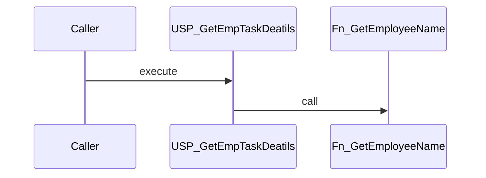
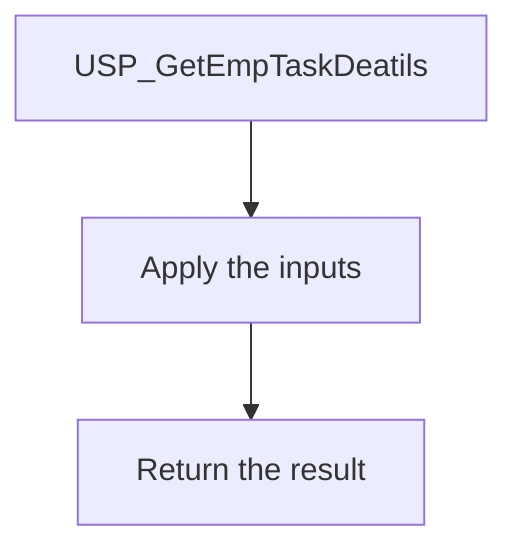

# USP_GetEmpTaskDeatils

## What it does

Returns Task Management progress rows for an employee and date window so TimeSheet can import pending tasks. Joins Task Master / Progress with project configuration and TimePort-named lookup objects (confirm synonyms per environment).

## Parameters

| Name | Direction | What it is for |
|---|---|---|
| `@employerid` | in | Employer id |
| `@EmployeeID` | in | Employee id |
| `@startdate` | in | Range start |
| `@endDate` | in | Range end |

## Call sequence

## Callers

Application caller: TimePort API `GetPendingTask` (core connection) for TimePort → TimeSheet import.

## Nested

| Object | Kind | When | Page |
|---|---|---|---|
| `Fn_GetEmployeeName` | function | Display name column | [Fn_GetEmployeeName](/docs/database/hrms/Fn_GetEmployeeName) |

## Steps

In `HRMS-DATABASE/HRMS/STOREPROCEDURE/USP_GetEmpTaskDeatils.sql`:

1. Select distinct task progress rows for the employee and date range.
2. Join `TTaskMaster`, `TProject`, `ttsprojectconfiguration`, and lookup tables for SDLC/activity names.
3. Use `Fn_GetEmployeeName` for EmpName.

## Tables

| Table | Read or write |
|---|---|
| `TTaskMaster` | read |
| `TTaskProgress` | read |
| `TProject` | read |
| `ttsprojectconfiguration` | read |
| `TTSLookUpTimePort` | read |
| `TTSLookUp` | read |
| `TEmployee` | read |

## Unresolved calls

None identified beyond the nested objects listed above.

## Flow

