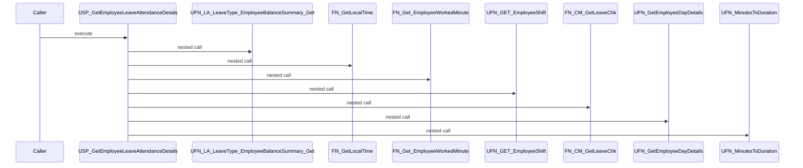
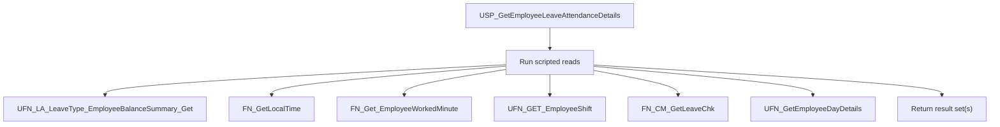

# USP_GetEmployeeLeaveAttendanceDetails

## What it does

Nested yearly leave/attendance detail for My Dashboard calendar card (Card 9).

## Parameters

| Name | Direction | What it is for |
|---|---|---|
| `@Employeeid` | in | `INT` |
| `@Month` | in | `INT` |
| `@Year` | in | `INT` |
| `@IncludeLeaveSummary` | in | `BIT` |

## Call sequence

## Callers

| Object | Kind | Page |
|---|---|---|
| `SP_LeaveAttendance_DashBoard` | procedure | [SP_LeaveAttendance_DashBoard](/docs/database/hrms/SP_LeaveAttendance_DashBoard) |

Also invoked via `SP_LeaveAttendance_DashBoard` yearly attendance card.

## Nested

| Object | Kind | When | Page |
|---|---|---|---|
| `UFN_LA_LeaveType_EmployeeBalanceSummary_Get` | function | when reached in script | [UFN_LA_LeaveType_EmployeeBalanceSummary_Get](/docs/database/hrms/UFN_LA_LeaveType_EmployeeBalanceSummary_Get) |
| `FN_GetLocalTime` | function | when reached in script | [FN_GetLocalTime](/docs/database/hrms/FN_GetLocalTime) |
| `FN_Get_EmployeeWorkedMinute` | function | when reached in script | [FN_Get_EmployeeWorkedMinute](/docs/database/hrms/FN_Get_EmployeeWorkedMinute) |
| `UFN_GET_EmployeeShift` | function | when reached in script | [UFN_GET_EmployeeShift](/docs/database/hrms/UFN_GET_EmployeeShift) |
| `FN_CM_GetLeaveChk` | function | when reached in script | [FN_CM_GetLeaveChk](/docs/database/hrms/FN_CM_GetLeaveChk) |
| `UFN_GetEmployeeDayDetails` | function | when reached in script | [UFN_GetEmployeeDayDetails](/docs/database/hrms/UFN_GetEmployeeDayDetails) |
| `UFN_MinutesToDuration` | function | when reached in script | [UFN_MinutesToDuration](/docs/database/hrms/UFN_MinutesToDuration) |

## Steps

1. In `HRMS-DATABASE/HRMS/STOREPROCEDURE/USP_GetEmployeeLeaveAttendanceDetails.sql`, accept the declared parameters and set `NOCOUNT` / read-uncommitted as scripted.
2. Build filter / reportee temp sets when the script calls nested helpers.
3. Aggregate leave/attendance (or tab ACL) rows and return the chart or card result set(s).

## Tables

| Table | Read or write |
|---|---|
| `dbo.TEmployeeInfo` | read |
| `dbo.TCalendarMaster` | read |
| `dbo.TCustomerSettings` | read |
| `dbo.TCalenderDays` | read |
| `dbo.TDailyRegisterNew` | read |
| `dbo.TSHIFTMASTER` | read |
| `dbo.TEmployee` | read |
| `dbo.TLeaveRequestDays` | read |
| `dbo.TLeaveRequest` | read |
| `dbo.TLeaveTypeMaster` | read |
| `dbo.D` | read |
| `dbo.TAttendanceRegularizationDays` | read |
| `dbo.TWorkfromHomeRequestDays` | read |
| `dbo.THolidayMaster` | read |
| `dbo.TOptionalHolidayRequest` | read |
| `dbo.dbo` | read |
| `dbo.TEmployeeDayWiseAttendanceStatus` | read |
| `dbo.tLeaveBalance` | read |

## Flow

