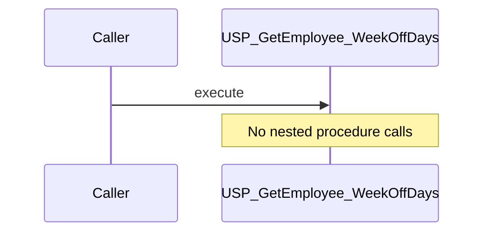
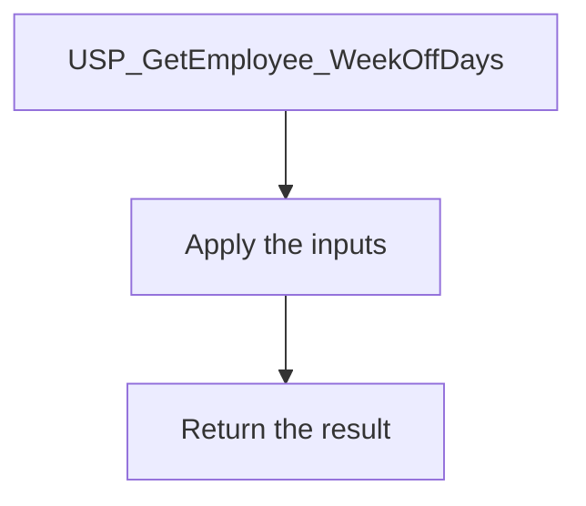

# USP_GetEmployee_WeekOffDays

## What it does

Returns week-off dates for one or more employees between two dates. Called from TimePort month-wise and attendance procedures via synonym on HRM-TIMEPORT.

## Parameters

| Name | Direction | What it is for |
|---|---|---|
| `@FromDate` | in | Range start |
| `@Todate` | in | Range end |
| `@EmployeeIDs` | in | CSV of employee ids (single id from TimeSheet callers) |

## Call sequence

## Callers

Nested from `Sp_TS_GetEmpTimeSheetMonthWise` and `Sp_TS_GetEmpTimeSeetAttendanceDetails` (TimePort synonym). Also used by other HRMS attendance surfaces.

## Nested

| Object | Kind | When | Page |
|---|---|---|---|
| _(none)_ | — | — | — |

## Steps

In `HRMS-DATABASE/HRMS/STOREPROCEDURE/USP_GetEmployee_WeekOffDays.sql`:

1. Split `@EmployeeIDs` into `#Employees`.
2. Compute week-off days from employee calendar / shift rules for the date range.
3. Return week-off date rows.

## Tables

| Table | Read or write |
|---|---|
| `TEmployee` | read |
| `TEmployeeInfo` | read |
| `Calendar / week-off related tables` | read |

## Unresolved calls

None identified beyond the nested objects listed above.

## Flow

