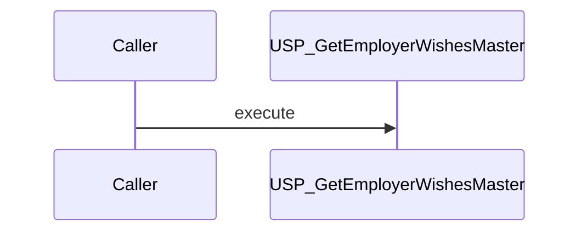
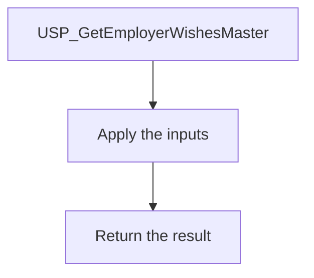

# USP_GetEmployerWishesMaster

## What it does

Returns the employer's default birthday and work-anniversary wish text for the header wish composer.

## Parameters

| Name | Direction | What it is for |
|---|---|---|
| `@EmployerID` | in | Employer that owns the data (`INT`) |

## Call sequence

## Callers

No other procedure or function under STOREPROCEDURE or FUNCTIONS executes this object.

## Nested

This object does not execute another procedure or user-defined function.

## Steps

In `HRMS-DATABASE/HRMS/STOREPROCEDURE/USP_GetEmployerWishesMaster.sql`:

1. Returns the employer's default birthday and work-anniversary wish text for the header wish composer.

## Tables

| Table | Read or write |
|---|---|
| `TEmployerWishesMaster` | read |

## Flow

