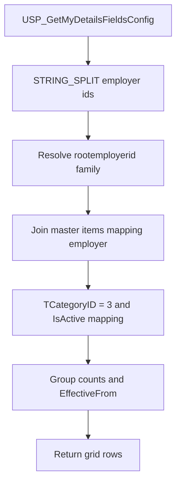

# USP_GetMyDetailsFieldsConfig

## What it does

Returns one aggregated My Details field-configuration row per organisation and section (`TCategoryID = 3`). For each group it reports the latest `EffectiveFrom`, total active mapped fields, and counts of mandatory versus non-mandatory fields. Employer scope is every organisation that shares a `rootemployerid` with any id in the comma-separated `@EmployerId` list.

## Parameters

| Name | Direction | What it is for |
|---|---|---|
| `@EmployerId` | in | Comma-separated employer ids used to resolve the root-employer family |

## Call sequence

Calls no other procedures or functions.

## Callers

No other procedure or function calls this object. Application caller: Core API `preOnBoardingDAL.GetMyDetailsConfiguration` for My Details Field Config.

## Nested

Calls no other procedures or functions.

## Steps

1. Script is `HRMS-DATABASE/HRMS/STOREPROCEDURE/USP_GetMyDetailsFieldsConfig.sql`.
2. Join `POBLookupMaster` to `POBLookupItems` and active `POBLookupEmployerMapping` rows, then to `TEmployerDetails`.
3. Restrict to employers whose `rootemployerid` matches any employer id from `STRING_SPLIT(@EmployerId, ',')`.
4. Restrict sections with `plm.TCategoryID = 3`.
5. Group by employer and section; compute `MAX(EffectiveFrom)`, field counts, and mandatory / non-mandatory sums.
6. Order by organisation name and `POBLookupID`.

## Tables

| Table | Read or write |
|---|---|
| `dbo.POBLookupMaster` | read |
| `dbo.POBLookupItems` | read |
| `dbo.POBLookupEmployerMapping` | read |
| `dbo.TEmployerDetails` | read |

## Flow

