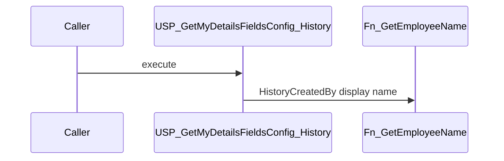
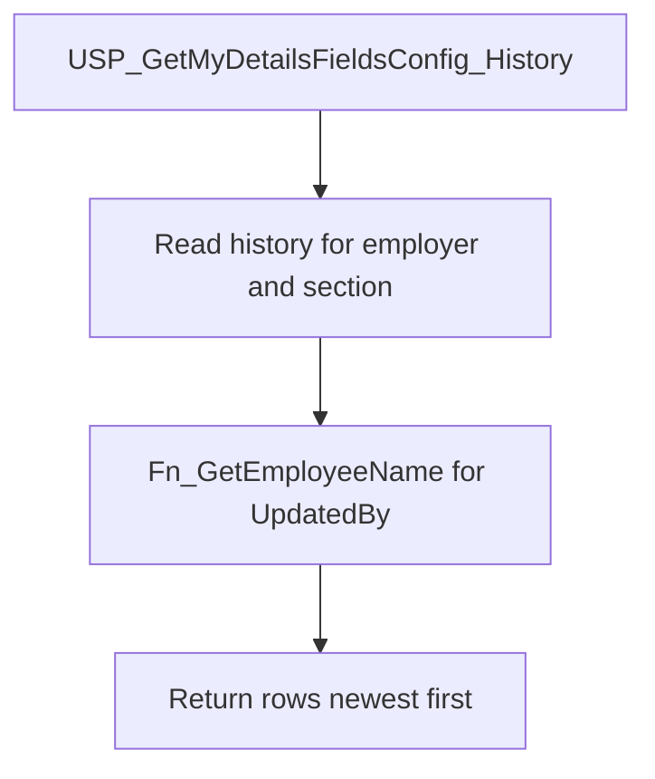

# USP_GetMyDetailsFieldsConfig_History

## What it does

Returns the change history for one employer and one My Details section from `POBLookupEmployerMapping_History`. Each row shows the field display text, old and new mandatory flags, old and new hide flags, the updater’s display name, and when the history row was written. Rows are newest first.

## Parameters

| Name | Direction | What it is for |
|---|---|---|
| `@EmployerID` | in | Employer whose history is listed |
| `@POBLookupID` | in | Section whose history is listed |

## Call sequence

## Callers

No other procedure or function calls this object. Application caller: Core API `preOnBoardingDAL.GetMyDetailsConfigurationHistory` for the Field Config history modal.

## Nested

| Object | Kind | When | Page |
|---|---|---|---|
| `Fn_GetEmployeeName` | function | every history row’s `UpdatedBy` | [Fn_GetEmployeeName](/docs/database/hrms/Fn_GetEmployeeName) |

## Steps

1. Script is `HRMS-DATABASE/HRMS/STOREPROCEDURE/USP_GetMyDetailsFieldsConfig_History.sql`.
2. Select from `POBLookupEmployerMapping_History` for `@EmployerID` and `@POBLookupID`.
3. Map `DisplayText` to `FieldName`, `IsMandatory` / `IsMandatory_NewValue`, `IsHide` / `IsHide_NewValue`, and `HistoryCreatedOn` to `UpdatedOn`.
4. Resolve `UpdatedBy` with `dbo.Fn_GetEmployeeName(HistoryCreatedBy)`.
5. Order by `HistoryCreatedOn` descending.

## Tables

| Table | Read or write |
|---|---|
| `dbo.POBLookupEmployerMapping_History` | read |

## Flow

