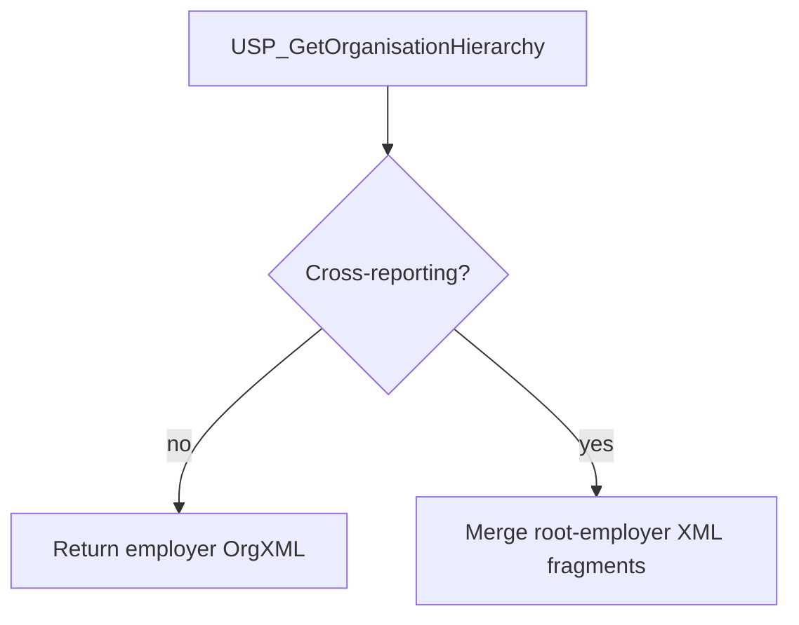

# USP_GetOrganisationHierarchy

## What it does

Returns organisation-hierarchy XML for an employer. When cross-reporting is off, returns that employer's `TOrganisationHierarchy` row plus the latest `TOrgHierarchyDetails.UnitID`. When cross-reporting is on, merges the latest hierarchy XML from every employer under the same root into one tree document.

## Parameters

| Name | Direction | What it is for |
|---|---|---|
| `@Employerid` | in | Organisation |

## Call sequence

Calls no other procedures or functions.

## Callers

No other procedure or function calls this object.

Node Define Workflow group popup loads the BU tree via `WorkflowDAL` → this procedure.

## Nested

Calls no other procedures or functions.

## Steps

1. Read `IsCrossReportingApplicable` and `RootEmployerId` from `TEmployerDetails` (`USP_GetOrganisationHierarchy.sql`).
2. When cross-reporting is `N`, return `OrgXML`, `Transid`, and the max `UnitID` for that employer.
3. When cross-reporting is on, collect the latest hierarchy row per employer under the root, strip each to its `<Node...` fragment, concatenate fragments under a shared Tree header/footer, and return the combined XML with `Transid = 0` and `LastNodeValue = 0`.

## Tables

| Table | Read or write |
|---|---|
| `TEmployerDetails` | read |
| `TOrganisationHierarchy` | read |
| `TOrgHierarchyDetails` | read |

## Flow

