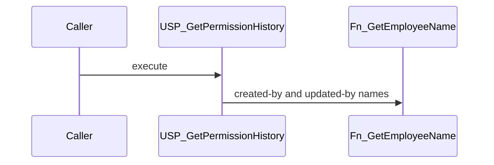
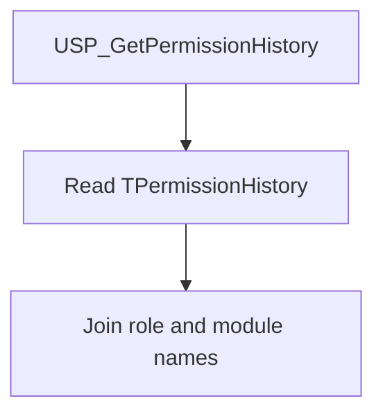

# USP_GetPermissionHistory

## What it does

Returns the history rows for one role CTC permission, with module name, role name, and the names of the creator and the last updater.

## Parameters

| Name | Direction | What it is for |
|---|---|---|
| `@EmployerID` | in | Organisation |
| `@PermissionID` | in | Permission whose history is read |

## Call sequence

## Callers

No other procedure or function calls this object.

`recruitmentDAL.getPermissionRolesHistory` calls it. The executed name in that method includes a trailing space.

## Nested

| Object | Kind | When | Page |
|---|---|---|---|
| `Fn_GetEmployeeName` | function | for `CreatedBy` and `UpdatedBy` | [Fn_GetEmployeeName](/docs/database/hrms/Fn_GetEmployeeName) |

## Steps

1. Select history columns from `TPermissionHistory` for the employer and permission (`USP_GetPermissionHistory.sql`).
2. Join `TRoles` on `RoleID` and `THRMSModules` on `ModuleID`.

## Tables

| Table | Read or write |
|---|---|
| `TPermissionHistory` | read |
| `TRoles` | read |
| `THRMSModules` | read |

## Flow

