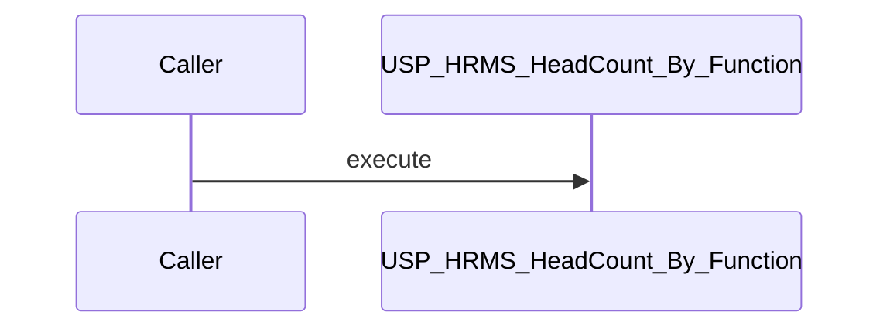
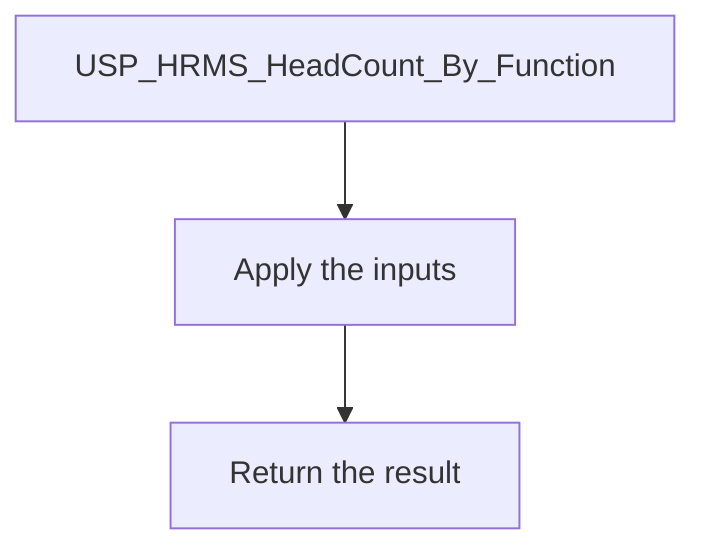

# USP_HRMS_HeadCount_By_Function

## What it does

Counts headcount by business unit (function) for one employer, using current employee info and history inside the date filter.

## Parameters

| Name | Direction | What it is for |
|---|---|---|
| `@EmployerId` | in | Employer that owns the data (`INT`) |
| `@BusinessUnitId` | in | Business-unit filter (`VARCHAR(100)`) |
| `@FromDate` | in | Filter start date (`Date`) |
| `@ToDate` | in | Filter end date (`Date`) |

## Call sequence

## Callers

No other procedure or function under STOREPROCEDURE or FUNCTIONS executes this object.

## Nested

This object does not execute another procedure or user-defined function.

## Steps

In `HRMS-DATABASE/HRMS/STOREPROCEDURE/USP_HRMS_HeadCount_By_Function.sql`:

1. Counts headcount by business unit (function) for one employer, using current employee info and history inside the date filter.

## Tables

| Table | Read or write |
|---|---|
| `tEmployee` | read |
| `tEmployeeInfo` | read |
| `TEmployerDetails` | read |
| `TEmployeeInfoHistory` | read |
| `Headcount` | read |
| `TOrgHierarchyDetails` | read |

## Flow

