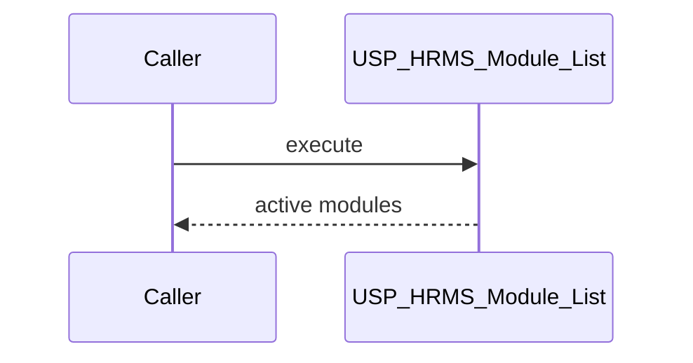
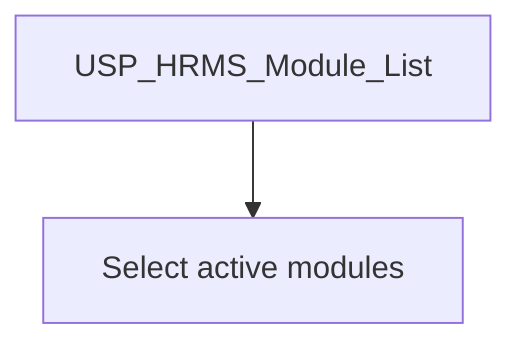

# USP_HRMS_Module_List

## What it does

Returns distinct active rows from `THrmsModules` (`ModuleId`, `ModuleName`, `IsDefault`) ordered by name for the licence module multi-select.

## Parameters

None.

## Call sequence

## Callers

No other procedure calls this object. `dashBoardDAL.GetModuleList` executes it from Manage Licenses.

## Nested

None.

## Steps

1. Select distinct active `THrmsModules` rows ordered by `ModuleName`.

## Tables

| Table | Read or write |
|---|---|
| `dbo.THrmsModules` | read |

## Unresolved calls

None.

## Flow

