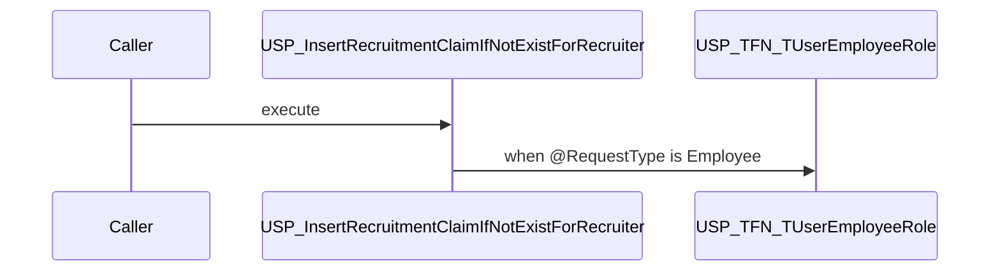
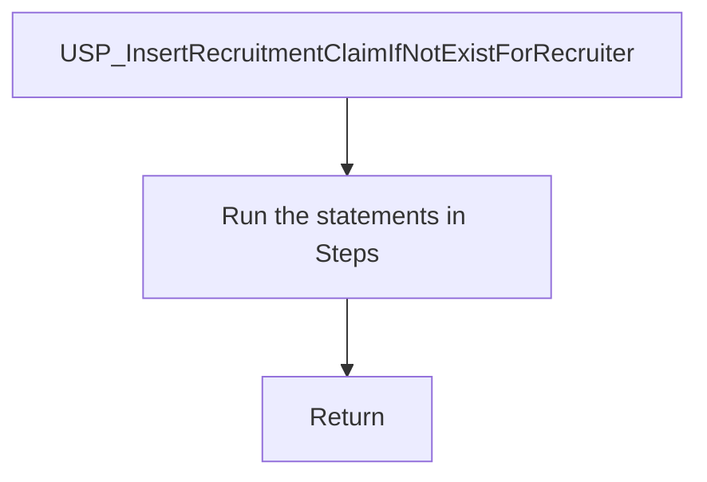

# USP_InsertRecruitmentClaimIfNotExistForRecruiter

## What it does

Ensures recruitment claim assignments exist for a recruiter. Access Right Management calls it with RequestType Role when the saved page list contains 617. For a role, a manual-approval customer and one of three named RHR roles receives every claim, RecruitmentAdmin receives every claim, and any other role receives the view-only claim set.

## Parameters

| Name | Direction | What it is for |
|---|---|---|
| `@Employeeid` | in | Employee. The role path from this screen passes null |
| `@Employerid` | in | Employer |
| `@RoleID` | in | Role. Used when @RequestType is Role |
| `@RequestType` | in | Employee or Role |
| `@CreatedBy` | in | Employee id stored on the assignment |

## Call sequence

## Callers

| Object | Kind | Page |
|---|---|---|
| `Sp_AdminRM_InsertRecruiter` | procedure | No page yet |
| `Sp_AdminRM_UpdateRecruiter` | procedure | No page yet |
| `SP_AdminRoleM_InsRolePageMapping` | procedure | [SP_AdminRoleM_InsRolePageMapping](/docs/database/hrms/SP_AdminRoleM_InsRolePageMapping) |
| `SP_AdminRoleM_InsRoles` | procedure | [SP_AdminRoleM_InsRoles](/docs/database/hrms/SP_AdminRoleM_InsRoles) |
| `SP_AdminRoleM_InsUserPageMap` | procedure | [SP_AdminRoleM_InsUserPageMap](/docs/database/hrms/SP_AdminRoleM_InsUserPageMap) |
| `SP_AdminRoleM_UpdRoles` | procedure | [SP_AdminRoleM_UpdRoles](/docs/database/hrms/SP_AdminRoleM_UpdRoles) |
| `SP_CM_ApproveAdminChangesRequest` | procedure | No page yet |
| `SP_CM_ApproveWorkFlowRequest` | procedure | No page yet |
| `SP_CM_ApproveWorkFlowRequest_240624` | procedure | No page yet |
| `SP_CM_ApproveWorkFlowRequestBKP03052025` | procedure | No page yet |
| `SP_CM_ApproveWorkFlowRequestbkp21032024` | procedure | No page yet |

## Nested

| Object | Kind | When | Page |
|---|---|---|
| `USP_TFN_TUserEmployeeRole` | function | when @RequestType is Employee | [USP_TFN_TUserEmployeeRole](/docs/database/hrms/USP_TFN_TUserEmployeeRole) |

## Steps

1. Read the recruiter row and TCustomerSettings.IsManualApproval. When the recruiter is inactive or deleted, mark assignments deleted and return.
2. Load claim definitions into temp tables, with a view-only subset.
3. When @RequestType is Employee, assign claims for that employee, using the role function when manual approval is on.
4. When @RequestType is Role and manual approval is on, assign every claim for the three named RHR role names.
5. Otherwise assign every claim when the role name is RecruitmentAdmin, and the view-only set for any other role name.

## Tables

| Table | Read or write |
|---|---|
| `TRecruiter` | read |
| `TCustomerSettings` | read |
| `TRecruitmentClaim` | read |
| `TRecruitmentClaim_ASSIGNMENT` | write |
| `TRoles` | read |
| `TEmployee` | read |

## Flow

