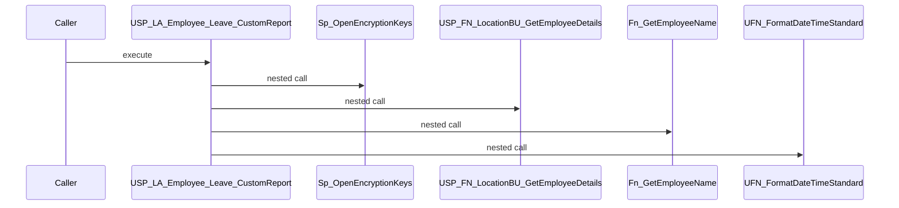
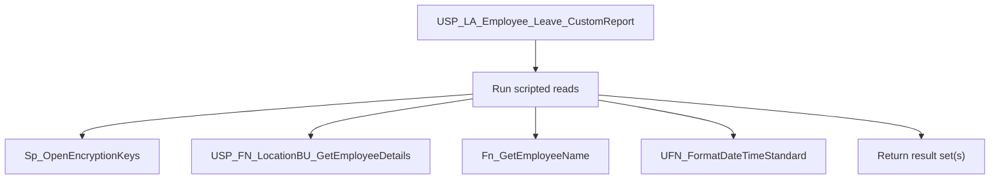

# USP_LA_Employee_Leave_CustomReport

## What it does

Nested leave custom-report fill used when building the My Dashboard leave summary card.

## Parameters

| Name | Direction | What it is for |
|---|---|---|
| `@FromDate` | in | `DATE` |
| `@ToDate` | in | `DATE` |
| `@Employerids` | in | `VARCHAR(MAX)` |
| `@Organizationunitid` | in | `VARCHAR(MAX)` |
| `@WorkLocationid` | in | `VARCHAR(MAX)` |
| `@BaseLocationid` | in | `VARCHAR(MAX)` |
| `@EmpIds` | in | `NVARCHAR(MAX)` |
| `@LeaveTransactionIds` | in | `NVARCHAR(MAX)` |
| `@ActiveStatus` | in | `VARCHAR(10)` |
| `@LoginEmployeeId` | in | `INT` |
| `@RequestType` | in | `VARCHAR(MAX)` |
| `@DateFilterType` | in | `CHAR(1)` |
| `@IncludePendingLeaves` | in | `BIT` |

## Call sequence

## Callers

| Object | Kind | Page |
|---|---|---|
| `SP_LeaveAttendance_DashBoard` | procedure | [SP_LeaveAttendance_DashBoard](/docs/database/hrms/SP_LeaveAttendance_DashBoard) |

Also invoked via `SP_LeaveAttendance_DashBoard` leave summary card.

## Nested

| Object | Kind | When | Page |
|---|---|---|---|
| `Sp_OpenEncryptionKeys` | procedure | when reached in script | [Sp_OpenEncryptionKeys](/docs/database/hrms/Sp_OpenEncryptionKeys) |
| `USP_FN_LocationBU_GetEmployeeDetails` | procedure | when reached in script | No page yet |
| `Fn_GetEmployeeName` | function | when reached in script | [Fn_GetEmployeeName](/docs/database/hrms/Fn_GetEmployeeName) |
| `UFN_FormatDateTimeStandard` | function | when reached in script | [UFN_FormatDateTimeStandard](/docs/database/hrms/UFN_FormatDateTimeStandard) |

## Steps

1. In `HRMS-DATABASE/HRMS/STOREPROCEDURE/USP_LA_Employee_Leave_CustomReport.sql`, accept the declared parameters and set `NOCOUNT` / read-uncommitted as scripted.
2. Build filter / reportee temp sets when the script calls nested helpers.
3. Aggregate leave/attendance (or tab ACL) rows and return the chart or card result set(s).

## Tables

| Table | Read or write |
|---|---|
| `dbo.STRING_SPLIT` | read |
| `dbo.TEmployerDetails` | read |
| `dbo.TCustomerSettings` | read |
| `dbo.TEmployee` | read |
| `dbo.TCalenderDays` | read |
| `dbo.TLeaveTypeMaster` | read |
| `dbo.TEmployeeInfo` | read |
| `dbo.TOrgHierarchyDetails` | read |
| `dbo.TMEmploymentTypes` | read |
| `dbo.TTitle` | read |
| `dbo.TLocation` | read |
| `dbo.TLeaveBalanceLedger` | read |
| `dbo.TLeaveTransactionSourceCategoryMap` | read |
| `dbo.R` | read |
| `dbo.curr` | read |
| `dbo.TLeaveRequestDays` | read |
| `dbo.TLeaveEncashmentRequest` | read |

## Flow

