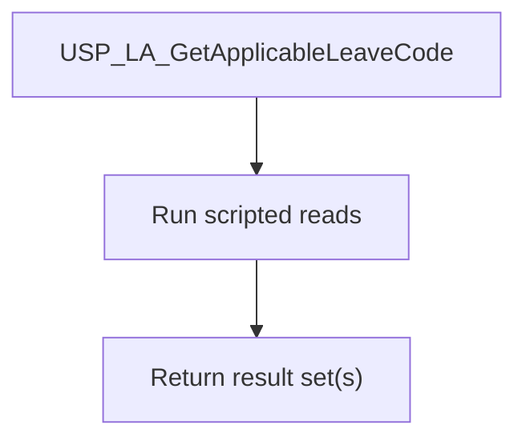

# USP_LA_GetApplicableLeaveCode

## What it does

Nested from My Dashboard leave card — applicable leave transaction ids for the employee.

## Parameters

| Name | Direction | What it is for |
|---|---|---|
| `@EmployeeID` | in | `INT` |
| `@EmployerID` | in | `INT` |
| `@LeaveTransactionId` | in | `INT` |

## Call sequence

Calls no other procedures or functions.

## Callers

| Object | Kind | Page |
|---|---|---|
| `SP_LeaveAttendance_DashBoard` | procedure | [SP_LeaveAttendance_DashBoard](/docs/database/hrms/SP_LeaveAttendance_DashBoard) |

Also invoked via `SP_LeaveAttendance_DashBoard` leave summary card.

## Nested

Calls no other procedures or functions.

## Steps

1. In `HRMS-DATABASE/HRMS/STOREPROCEDURE/USP_LA_GetApplicableLeaveCode.sql`, accept the declared parameters and set `NOCOUNT` / read-uncommitted as scripted.
2. Run the SELECT branches shown in the script and return the result set(s).

## Tables

| Table | Read or write |
|---|---|
| `dbo.TEmployee` | read |
| `dbo.TEmployeeInfo` | read |
| `dbo.TLeaveTypeMaster` | read |
| `dbo.TLeaveBusinessUnit` | read |
| `dbo.TLeaveGrade` | read |
| `dbo.TLeaveLocation` | read |
| `dbo.TLeaveEmployeeStatus` | read |
| `dbo.TLeaveCalendar` | read |
| `dbo.STRING_SPLIT` | read |

## Flow

