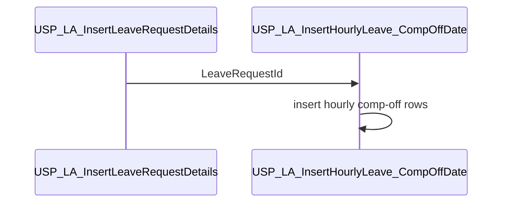
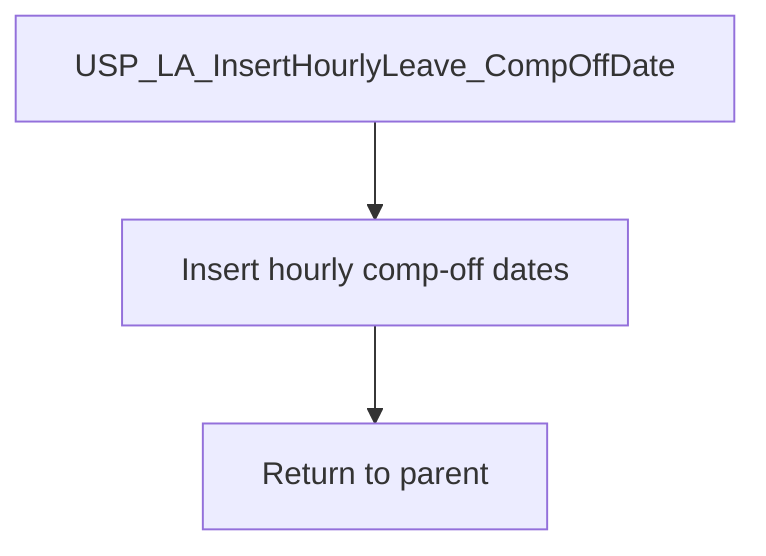

# USP_LA_InsertHourlyLeave_CompOffDate

## What it does

Persists hourly leave comp-off worked-on associations for a newly inserted leave request.

## Parameters

| Name | Direction | What it is for |
|---|---|---|
| `@LeaveRequestId` | in | New `TLeaveRequest.TransId` |
| Hourly comp-off inputs | in | See script |

## Call sequence

## Callers

| Object | Kind | Page |
|---|---|---|
| `USP_LA_InsertLeaveRequestDetails` | procedure | [USP_LA_InsertLeaveRequestDetails](/docs/database/hrms/USP_LA_InsertLeaveRequestDetails) |

## Nested

No further procedure EXECs on the common path.

## Steps

1. Accept leave request id from parent.
2. Insert hourly comp-off association rows.

## Tables

| Table | Read or write |
|---|---|
| Hourly comp-off association table(s) | write |

## Unresolved calls

None.

## Flow

