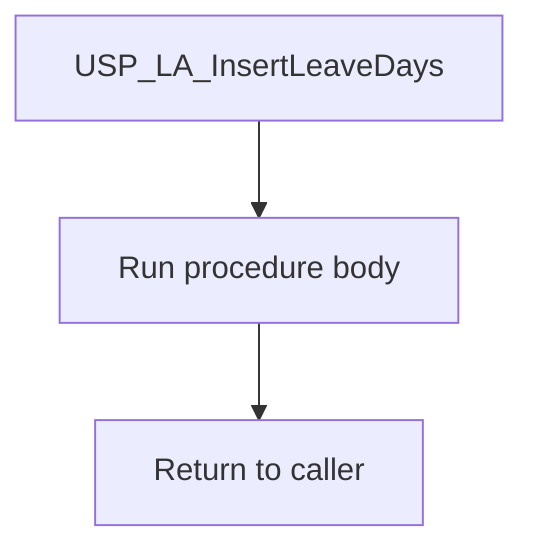

# USP_LA_InsertLeaveDays

## What it does

Materializes leave day rows (or dropdown preview) from LeaveDateType TVP and leave-type intervening rules.

## Parameters

| Name | Direction | What it is for |
|---|---|---|
| `@LeaveRequestId` | in | 0 for preview |
| `@Employeeid` | in | Employee |
| `@LeaveCode` | in | Leave code |
| `@Fromdate` | in | From |
| `@ToDate` | in | To |
| `@FromHalfDay` | in | From half |
| `@ToHalfDay` | in | To half |
| `@InsertRecord` | in | Y insert |
| `@LeaveDetails` | in | LeaveDateType TVP |
| `@ModeOfOperation` | in | Y apply / D dropdown |

## Call sequence

Calls no other procedures or functions.

## Callers

| Object | Kind | Page |
|---|---|---|
| `USP_LA_ValidateLeaveRequest` | procedure | [USP_LA_ValidateLeaveRequest](/docs/database/hrms/USP_LA_ValidateLeaveRequest) |

## Nested

Calls no other procedures or functions.

## Steps

1. Expand LeaveDetails / range.
2. Flag WO/Holiday/optional holiday.
3. Insert day rows when requested.

## Tables

| Table | Read or write |
|---|---|
| `TLeaveRequestDays` | write when InsertRecord=Y |

## Flow

