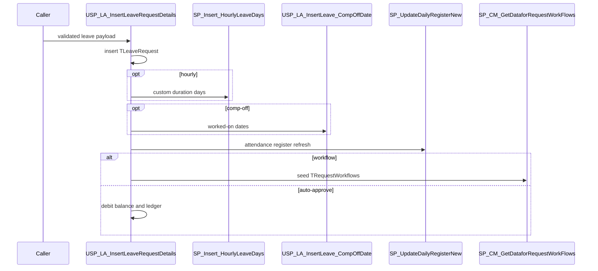
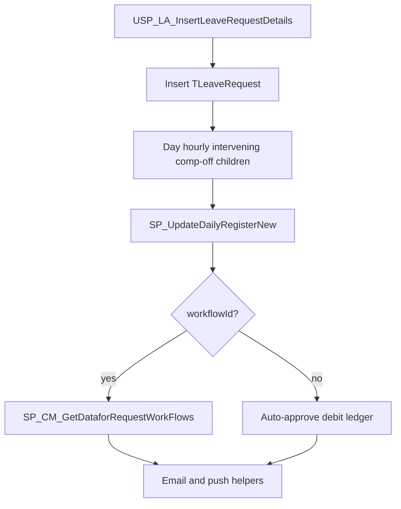

# USP_LA_InsertLeaveRequestDetails

## What it does

Inserts a leave request for L&A Tasks after validation. Writes `TLeaveRequest` (and day / hourly / comp-off children), optionally auto-approves and debits balance when no workflow, or seeds `TRequestWorkflows` when a workflow is mapped. Updates daily register and queues email / push notification helpers.

## Parameters

| Name | Direction | What it is for |
|---|---|---|
| `@LeaveCode` | in | Leave type |
| `@EmployeeId` | in | Applicant |
| `@Fromdate` / `@Todate` | in | Range |
| `@FromHalfday` / `@TohalfDay` | in | Half-day flags |
| `@Workhandedoverto` / `@SupportDoc` / `@Reason` / `@LeaveAddress` / `@PhoneNo` | in | Form fields |
| `@NoofDays` | in | Day/hour count from validate |
| `@RequestType` / `@workflowId` / `@Createdby` / `@Employerid` | in | Routing context |
| `@TransId` | out | New leave trans id |
| `@DocPath` | out | Attachment folder path |
| `@LeaveDet` / `@UDT_CompOffDates` / `@UDT_CustomDuration` / `@LeaveRequestDays` / intervening TVPs | in | Day breakdowns |
| `@LeaveEvent` / `@IsLeaveReasonFreeText` / `@LeaveTypeReasonId` / `@EventLeaveClaimRequestId` | in | Event / reason options |
| `@RequestSource` | in | `Web` / `Mobile` |

## Call sequence

## Callers

| Object | Kind | Page |
|---|---|---|
| `LeaveDAL.ApplyLeaves` | app | [L&A Tasks](/docs/guides/leave-and-attendance/l-a-tasks) |

## Nested

| Object | Kind | When | Page |
|---|---|---|---|
| `SP_Insert_HourlyLeaveDays` | procedure | hour-based leave | [SP_Insert_HourlyLeaveDays](/docs/database/hrms/SP_Insert_HourlyLeaveDays) |
| `USP_LA_InsertLeave_CompOffDate` | procedure | day-based comp-off dates | [USP_LA_InsertLeave_CompOffDate](/docs/database/hrms/USP_LA_InsertLeave_CompOffDate) |
| `USP_LA_InsertHourlyLeave_CompOffDate` | procedure | hourly comp-off dates | [USP_LA_InsertHourlyLeave_CompOffDate](/docs/database/hrms/USP_LA_InsertHourlyLeave_CompOffDate) |
| `SP_UpdateDailyRegisterNew` | procedure | attendance register | [SP_UpdateDailyRegisterNew](/docs/database/hrms/SP_UpdateDailyRegisterNew) |
| `USP_Leave_PushNotification_Insert` | procedure | push notification | No SQL file in `HRMS-DATABASE/HRMS` (unresolved) |
| `SP_CM_GetDataforRequestWorkFlows` | procedure | workflow seed | [SP_CM_GetDataforRequestWorkFlows](/docs/database/hrms/SP_CM_GetDataforRequestWorkFlows) |
| `SP_CM_GetDataForEmailNotification` | procedure | email payload | [SP_CM_GetDataForEmailNotification](/docs/database/hrms/SP_CM_GetDataForEmailNotification) |
| `SP_UpdateAutoApprovalRejection` | procedure | auto-approve path | [SP_UpdateAutoApprovalRejection](/docs/database/hrms/SP_UpdateAutoApprovalRejection) |

## Steps

1. Script is `HRMS-DATABASE/HRMS/STOREPROCEDURE/USP_LA_InsertLeaveRequestDetails.sql`.
2. Insert header into `TLeaveRequest`; materialize day / hourly / intervening / comp-off children.
3. Refresh daily register for affected dates.
4. If workflow id present, call `SP_CM_GetDataforRequestWorkFlows` and email/push helpers with Pending status.
5. If auto-approve, debit `tLeaveBalance` / `TLeaveBalanceLedger` and run auto-approval helper.

## Tables

| Table | Read or write |
|---|---|
| `TLeaveRequest` | write |
| `TLeaveRequestDays` / hourly / comp-off child tables | write |
| `TRequestWorkflows` | write when workflow |
| `tLeaveBalance` / `TLeaveBalanceLedger` | write on auto-approve |
| `tDailyRegisterNew` | write via nested register SP |

## Unresolved calls

`USP_Leave_PushNotification_Insert` is EXECd from this script but has no matching `.sql` under `HRMS-DATABASE/HRMS` in this workspace.

## Flow

