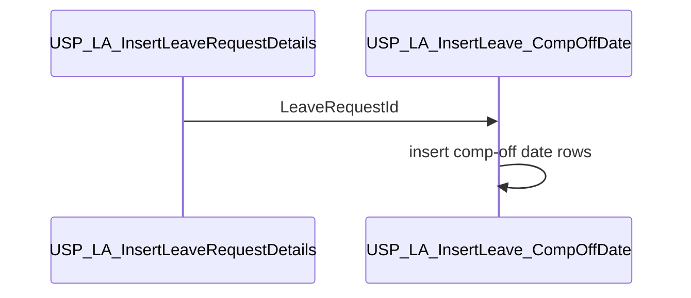
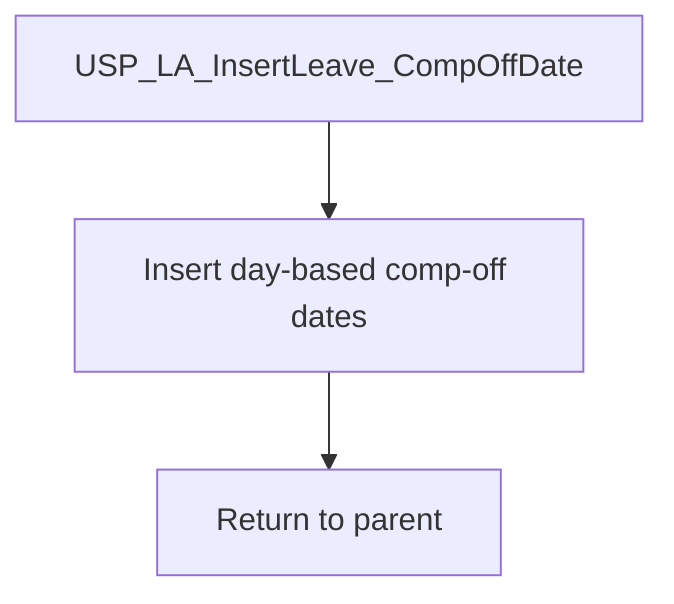

# USP_LA_InsertLeave_CompOffDate

## What it does

Persists day-based comp-off worked-on dates linked to a newly inserted leave request (`@LeaveRequestId`).

## Parameters

| Name | Direction | What it is for |
|---|---|---|
| `@LeaveRequestId` | in | New `TLeaveRequest.TransId` |
| Comp-off date TVP / related inputs | in | See script |

## Call sequence

## Callers

| Object | Kind | Page |
|---|---|---|
| `USP_LA_InsertLeaveRequestDetails` | procedure | [USP_LA_InsertLeaveRequestDetails](/docs/database/hrms/USP_LA_InsertLeaveRequestDetails) |

## Nested

No further procedure EXECs on the common path.

## Steps

1. Accept leave request id and comp-off dates from parent.
2. Insert day-based comp-off association rows.

## Tables

| Table | Read or write |
|---|---|
| Comp-off date association table(s) | write |

## Unresolved calls

None.

## Flow

