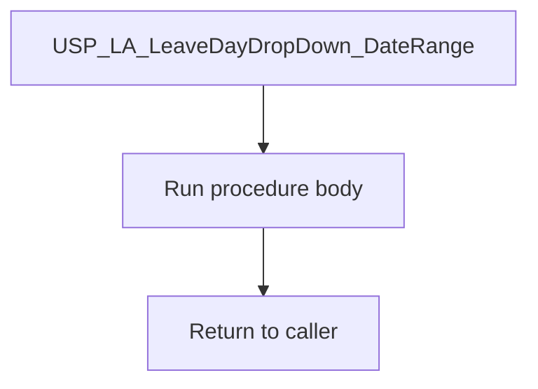

# USP_LA_LeaveDayDropDown_DateRange

## What it does

Builds the leave day dropdown / day breakdown for a selected date range, including intervening holidays and weekly offs when enabled.

## Parameters

| Name | Direction | What it is for |
|---|---|---|
| `@EmployerID` | in | Employer |
| `@EmployeeID` | in | Employee |
| `@LeaveCode` | in | Leave code |
| `@Fromdate` | in | From |
| `@ToDate` | in | To |
| `@InterveningFromDate` | in | optional |
| `@InterveningToDate` | in | optional |
| `@IsIntervening` | in | optional |
| `@CalledFrom` | in | optional caller label |

## Call sequence

Calls no other procedures or functions.

## Callers

| Object | Kind | Page |
|---|---|---|
| `USP_LA_ValidateLeaveRequest` | procedure | [USP_LA_ValidateLeaveRequest](/docs/database/hrms/USP_LA_ValidateLeaveRequest) |

## Nested

Calls no other procedures or functions.

## Steps

1. Expand dates in range.
2. Flag holiday/weekly-off/optional holiday days.
3. Return day list for UI dropdown.

## Tables

| Table | Read or write |
|---|---|
| `calendar / leave type` | read |

## Flow

