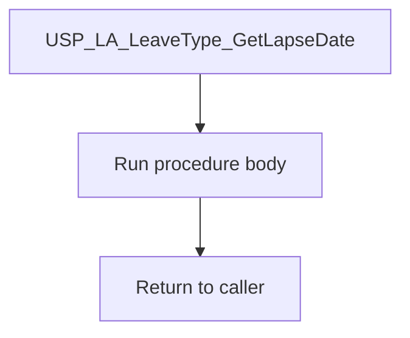

# USP_LA_LeaveType_GetLapseDate

## What it does

Returns leave-type lapse / cycle boundary dates for an employee (optionally all boundaries).

## Parameters

| Name | Direction | What it is for |
|---|---|---|
| `@EmployeeId` | in | Employee |
| `@EmployerId` | in | Employer |
| `@LeaveCode` | in | optional leave code |
| `@ReturnAllBoundaries` | in | 0/1 |

## Call sequence

Calls no other procedures or functions.

## Callers

| Object | Kind | Page |
|---|---|---|
| `USP_LA_ValidateLeaveRequest` | procedure | [USP_LA_ValidateLeaveRequest](/docs/database/hrms/USP_LA_ValidateLeaveRequest) |
| `SP_LA_UpdateLeavePullBack` | procedure | [SP_LA_UpdateLeavePullBack](/docs/database/hrms/SP_LA_UpdateLeavePullBack) |

## Nested

Calls no other procedures or functions.

## Steps

1. Resolve policy applicable dates.
2. Return current lapse/boundary set for balance validators.

## Tables

| Table | Read or write |
|---|---|
| `leave policy / balance cycle tables` | read |

## Flow

