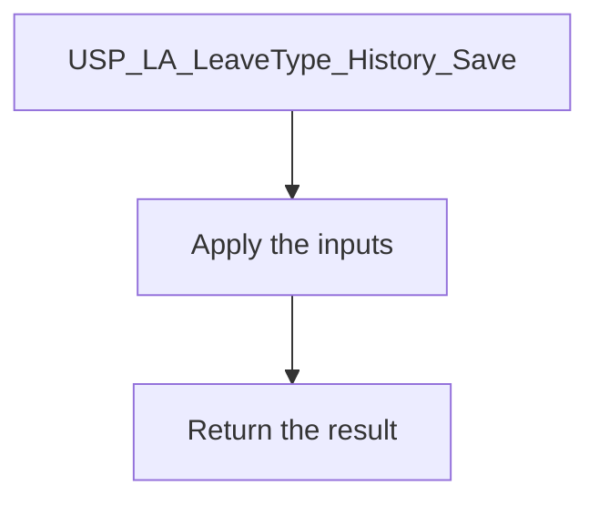

# USP_LA_LeaveType_History_Save

## What it does

Persists leave-type history after an update.

## Parameters

No parameters were parsed from the script signature.

## Call sequence

Calls no other procedures or functions.

## Callers

| Object | Kind | Page |
|---|---|---|
| `USP_LA_LeaveType_Approve` | procedure | No page yet |
| `USP_LA_LeaveType_Update` | procedure | [USP_LA_LeaveType_Update](/docs/database/hrms/USP_LA_LeaveType_Update) |

## Nested

Calls no other procedures or functions.

## Steps

In `HRMS-DATABASE/HRMS/STOREPROCEDURE/USP_LA_LeaveType_History_Save.sql`:
1. Accept the declared parameters and run the procedure or function body.
4. Return result sets, scalar values, or status as defined in the script.

## Tables

No `T*` tables were matched in a simple FROM/JOIN/INSERT/UPDATE/DELETE scan.

## Flow

