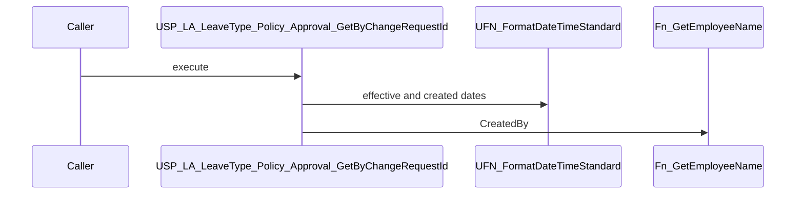
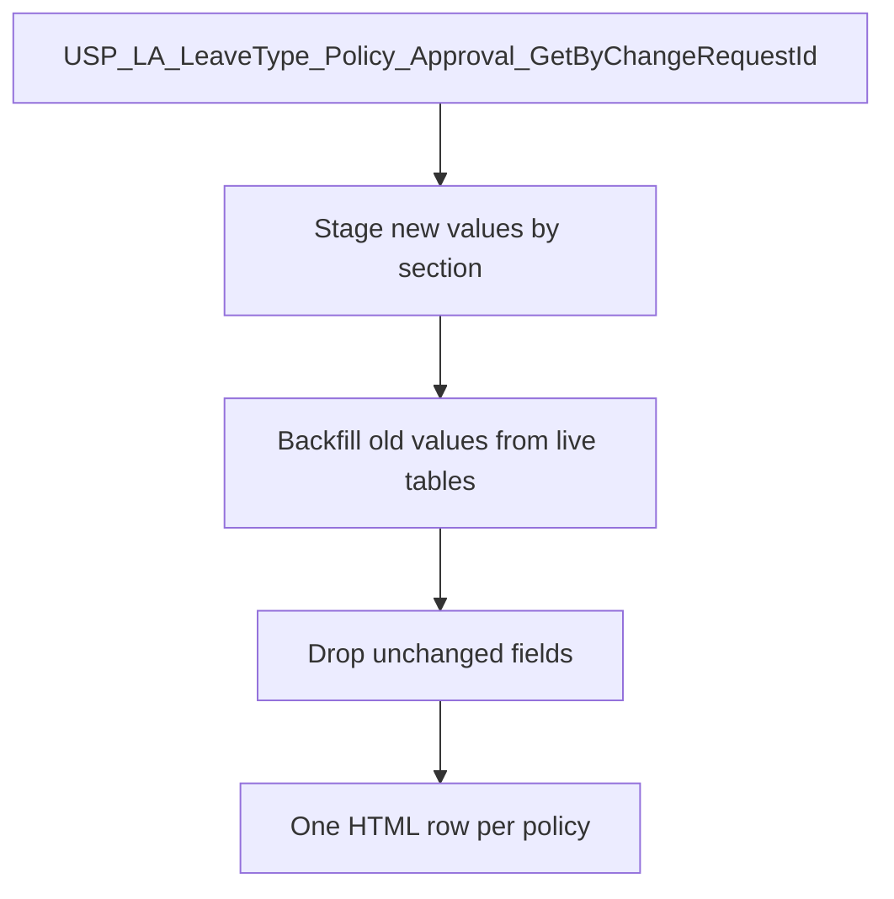

# USP_LA_LeaveType_Policy_Approval_GetByChangeRequestId

## What it does

Builds the old and new HTML for leave-policy changes filed under one change request. It compares `*_ChangeApproval` rows with the live policy tables, drops fields whose values match, and returns one row per policy with section HTML.

## Parameters

| Name | Direction | What it is for |
|---|---|---|
| `@RequestTransId` | in | `TAdminChangesApprovals.ChangeRequestID` whose policy staging rows are read. |

## Call sequence

## Callers

Procedures and functions whose live statements invoke this object. Views are omitted.

| Object | Kind | Page |
|---|---|---|
| `SP_AdminSCCT_GetChangesForApproval` | procedure | [SP_AdminSCCT_GetChangesForApproval](/docs/database/hrms/SP_AdminSCCT_GetChangesForApproval) |

## Nested

| Object | Kind | When | Page |
|---|---|---|---|
| `UFN_FormatDateTimeStandard` | function | policy effective date and created-when | [UFN_FormatDateTimeStandard](/docs/database/hrms/UFN_FormatDateTimeStandard) |
| `Fn_GetEmployeeName` | function | policy CreatedBy | [Fn_GetEmployeeName](/docs/database/hrms/Fn_GetEmployeeName) |

## Steps

From `HRMS-DATABASE/HRMS/STOREPROCEDURE/USP_LA_LeaveType_Policy_Approval_GetByChangeRequestId.sql`.

1. Insert leave-policy fields from `TLeavePolicy_ChangeApproval` (standard flag, rule name, effective date, priority, active, created by, created when).
2. Insert policy parameters from `TLeavePolicyParameterValue_ChangeApproval`, excluding `TierCreditDays`, aggregated by parameter name.
3. Insert lapse and carry-forward fields from `TLeaveLapseCarryForwardConfig_ChangeApproval`.
4. Backfill old values from `TLeavePolicy` and `TLeaveLapseCarryForwardConfig` for the same policy id.
5. Insert event-leave rule fields from `TEventLeaveRuleConfig_ChangeApproval`, then old values from `TEventLeaveRuleConfig`.
6. Insert policy preference from `TPolicyPreference_ChangeApproval`, then the live `TPolicyPreference` value where `PolicyApplicableTo = EventLeaveRule`.
7. Insert one relationship-tier row per `TEmergencyRelationship` from parameter `RelationshipCreditDays`, then the live parameter value.
8. Delete rows where the displayed new value equals the displayed old value, including a date-normalised comparison.
9. Return `RuleName` (`Rule:` plus policy name), `NewHtml`, and `OldHtml`. Sections are ordered Leave Policy, Policy Parameters, Lapse and Carry Forward, Event Leave Rule, Policy Preference, Relationship Tier Credit.

## Tables

| Table | Read or write |
|---|---|
| `TLeavePolicy_ChangeApproval` | read |
| `TLeavePolicy` | read |
| `TLeavePolicyParameterValue_ChangeApproval` | read |
| `TLeavePolicyParameter` | read |
| `TLeavePolicyParameterValue` | read |
| `TLeaveLapseCarryForwardConfig_ChangeApproval` | read |
| `TLeaveLapseCarryForwardConfig` | read |
| `TEventLeaveRuleConfig_ChangeApproval` | read |
| `TEventLeaveRuleConfig` | read |
| `TPolicyPreference_ChangeApproval` | read |
| `TPolicyPreference` | read |
| `TEmergencyRelationship` | read |

## Flow

