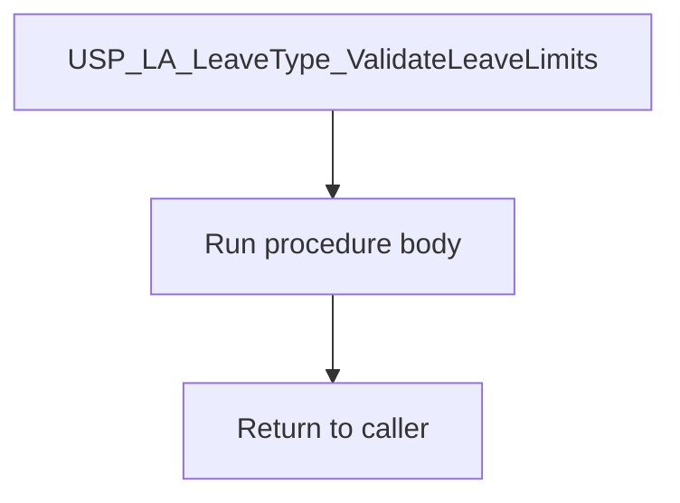

# USP_LA_LeaveType_ValidateLeaveLimits

## What it does

Enforces leave-type min/max and period limits (with optional hour-based overrides and SkipOnceOnlyChecks for multi-call validate).

## Parameters

| Name | Direction | What it is for |
|---|---|---|
| `@Employeeid` | in | Employee |
| `@Employerid` | in | Employer |
| `@DOJ` | in | Date of joining |
| `@LeaveCode` | in | Leave code |
| `@Fromdate` | in | From |
| `@ToDate` | in | To |
| `@ThisRequestDays` | in | Days in this request |
| `@Message_ValidateLeaveLimits` | out | Message |
| `@IsValid_ValidateLeaveLimits` | out | Validity |
| `@LeaveType` | in | Day Based / Hour Based |
| `@OverrideMaxDaysToApply` | in | optional |
| `@OverrideMaxLeaveAvailOption` | in | optional |
| `@UnitLabel` | in | days/hours label |
| `@LimitDisplayValue` | in | optional display |
| `@SkipOnceOnlyChecks` | in | skip once-only sections |

## Call sequence

Calls no other procedures or functions.

## Callers

| Object | Kind | Page |
|---|---|---|
| `USP_LA_ValidateLeaveRequest` | procedure | [USP_LA_ValidateLeaveRequest](/docs/database/hrms/USP_LA_ValidateLeaveRequest) |

## Nested

Calls no other procedures or functions.

## Steps

1. Resolve payroll/period windows.
2. Run min/max and period limit sections.
3. Set IsValid and message outputs.

## Tables

| Table | Read or write |
|---|---|
| `TLeaveTypeMaster / TLeaveRequest` | read |

## Flow

