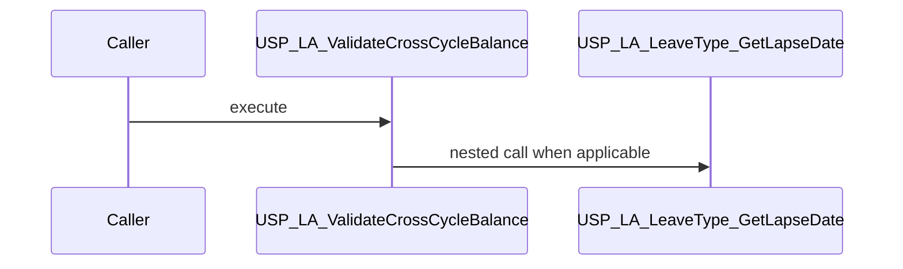
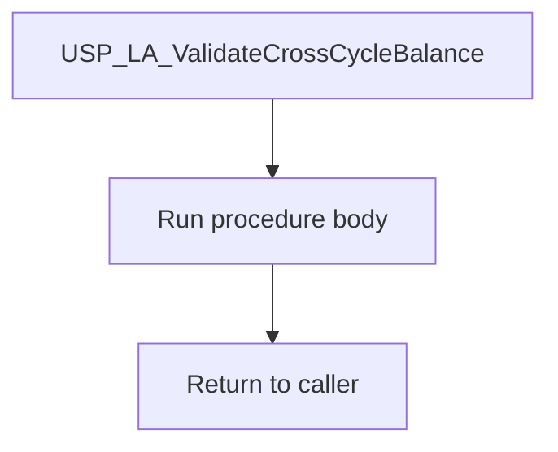

# USP_LA_ValidateCrossCycleBalance

## What it does

Validates projected leave balance across cycle boundaries, including negative-balance limits.

## Parameters

| Name | Direction | What it is for |
|---|---|---|
| `@EmployeeId` | in | Employee |
| `@EmployerId` | in | Employer |
| `@LeaveCode` | in | Leave code |
| `@NegativeBalanceAllowed` | in | flag |
| `@NegativeBalanceLimit` | in | limit |
| `@IsValid` | out | Validity |
| `@ProjectedBalance` | out | Projected |
| `@ConsumedCrossCycleDays` | out | Cross-cycle days |

## Call sequence

## Callers

| Object | Kind | Page |
|---|---|---|
| `USP_LA_ValidateLeaveRequest` | procedure | [USP_LA_ValidateLeaveRequest](/docs/database/hrms/USP_LA_ValidateLeaveRequest) |

## Nested

| Object | Kind | When | Page |
|---|---|---|---|
| `USP_LA_LeaveType_GetLapseDate` | procedure | boundary dates | [USP_LA_LeaveType_GetLapseDate](/docs/database/hrms/USP_LA_LeaveType_GetLapseDate) |

## Steps

1. Get lapse boundaries.
2. Project consumption across cycles.
3. Set IsValid and projected balance outputs.

## Tables

| Table | Read or write |
|---|---|
| `tLeaveBalance / ledger` | read |

## Flow

