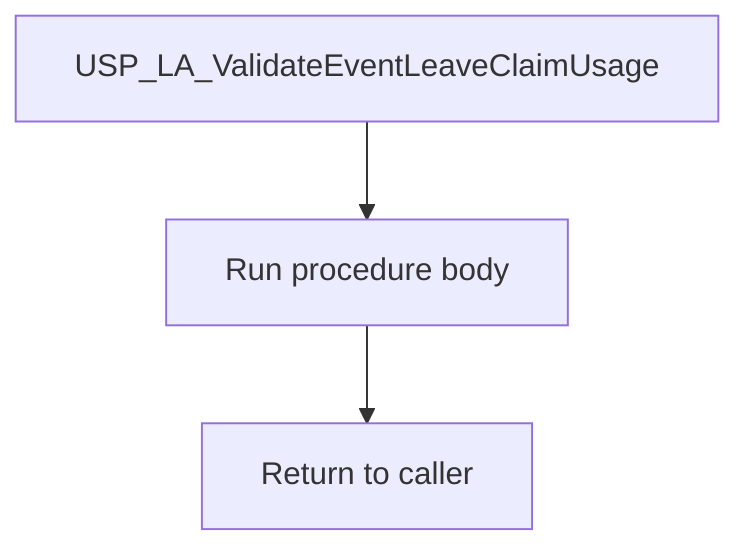

# USP_LA_ValidateEventLeaveClaimUsage

## What it does

Validates that an event-leave claim still has remaining capacity for the requested amount.

## Parameters

| Name | Direction | What it is for |
|---|---|---|
| `@EmployeeId` | in | Employee |
| `@LeaveTransactionId` | in | Leave transaction |
| `@EventLeaveClaimRequestId` | in | Claim id |
| `@RequestedAmount` | in | Amount |
| `@FromDate` | in | From |
| `@UnitLabel` | in | day(s)/hours label |
| `@IsValid` | out | Validity |
| `@ErrorMessage` | out | Error |

## Call sequence

Calls no other procedures or functions.

## Callers

| Object | Kind | Page |
|---|---|---|
| `USP_LA_ValidateLeaveRequest` | procedure | [USP_LA_ValidateLeaveRequest](/docs/database/hrms/USP_LA_ValidateLeaveRequest) |

## Nested

Calls no other procedures or functions.

## Steps

1. Load claim status and utilized sum.
2. Compare RequestedAmount to remaining.
3. Set IsValid / ErrorMessage.

## Tables

| Table | Read or write |
|---|---|
| `event leave claim / usage tables` | read |

## Flow

