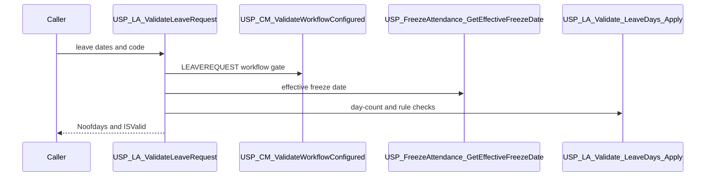
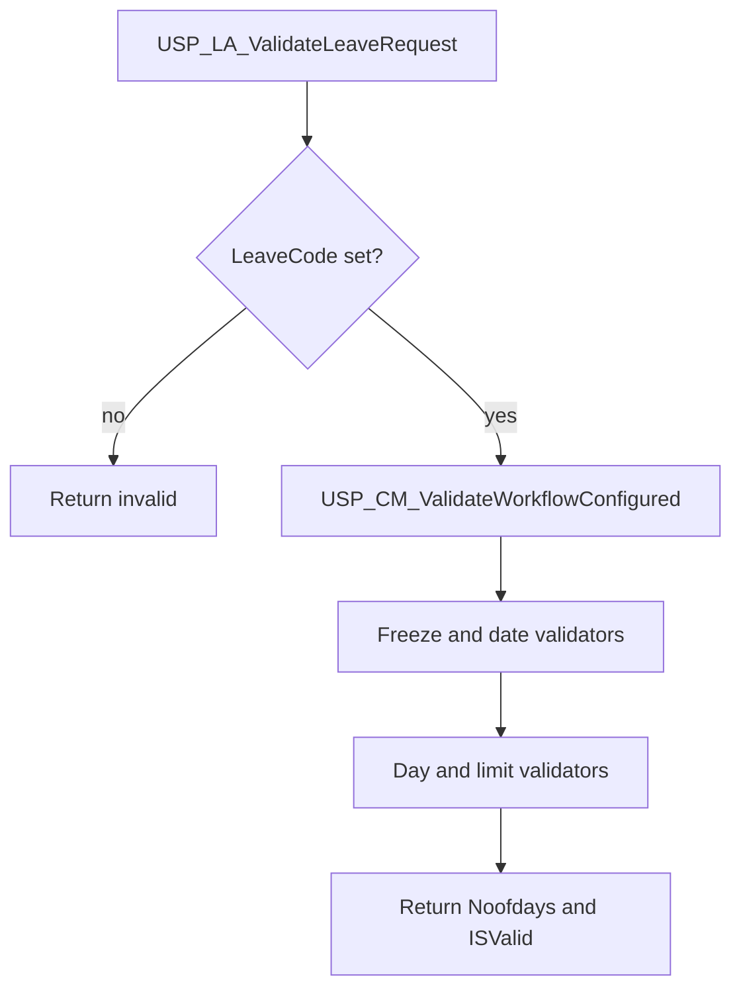

# USP_LA_ValidateLeaveRequest

## What it does

Pre-apply leave validator for WebForms L&A Tasks (and mobile/import siblings). Checks leave code, workflow configuration, freeze date, from/to and intervening ranges, balance / day math, resignation windows, event-leave claim usage, lapse dates, cross-cycle balance, and leave limits. Returns `Noofdays`, validity flags, and optional day breakdown result sets used before `USP_LA_InsertLeaveRequestDetails`.

## Parameters

| Name | Direction | What it is for |
|---|---|---|
| `@Employeeid` | in | Employee applying |
| `@LeaveCode` | in | Leave type code |
| `@Fromdate` / `@Todate` | in | Request range |
| `@FromHalfday` / `@TohalfDay` | in | Half-day flags |
| `@ModeOfOperation` | in | Preview vs commit-oriented mode |
| `@InterveningFromDate` / `@InterveningToDate` / `@IsIntervening` | in | Intervening holiday/week-off window |
| `@IsPreview` | in | Preview flag |
| `@LeaveDet` | in | `LeaveDateType` TVP of selected dates |
| `@UDT_CompOffDates` | in | Comp-off date TVP when applicable |
| `@EventLeaveClaimRequestId` | in | Optional event-leave claim link |
| `@RequestSource` | in | `Web` / `Mobile` (when present on live script) |

## Call sequence

## Callers

| Object | Kind | Page |
|---|---|---|
| `LeaveDAL.ValidateLeaveRequest` | app | [L&A Tasks](/docs/guides/leave-and-attendance/l-a-tasks) |

## Nested

| Object | Kind | When | Page |
|---|---|---|---|
| `USP_CM_ValidateWorkflowConfigured` | procedure | workflow / auto-approve gate | [USP_CM_ValidateWorkflowConfigured](/docs/database/hrms/USP_CM_ValidateWorkflowConfigured) |
| `USP_FreezeAttendance_GetEffectiveFreezeDate` | procedure | freeze cut-off | [USP_FreezeAttendance_GetEffectiveFreezeDate](/docs/database/hrms/USP_FreezeAttendance_GetEffectiveFreezeDate) |
| `USP_LA_Validate_Leave_FromToDate` | procedure | range validity | No page yet |
| `USP_LA_Validate_Leave_Intervening_Date` | procedure | intervening window | No page yet |
| `USP_LA_LeaveDayDropDown_DateRange` | procedure | day dropdown rebuild | No page yet |
| `USP_LA_Validate_Leave_Resignation` | procedure | notice / exit window | No page yet |
| `USP_LA_Validate_LeaveDays_Apply` | procedure | day accounting rules | No page yet |
| `USP_LA_InsertLeaveDays` | procedure | temp day materialization | No page yet |
| `USP_LA_ValidateEventLeaveClaimUsage` | procedure | event claim usage | No page yet |
| `USP_LA_LeaveType_GetLapseDate` | procedure | lapse / expiry | No page yet |
| `USP_LA_ValidateCrossCycleBalance` | procedure | cross-cycle balance | No page yet |
| `USP_LA_LeaveType_ValidateLeaveLimits` | procedure | min/max limits | No page yet |

## Steps

1. Script is `HRMS-DATABASE/HRMS/STOREPROCEDURE/USP_LA_ValidateLeaveRequest.sql`.
2. Reject empty leave code; resolve employer / DOB / wedding date from `TEmployee`.
3. Read `TCustomerSettings.IsLeaveAutoApproveIfNoWorkflow`; call `USP_CM_ValidateWorkflowConfigured` for `LEAVEREQUEST`.
4. Run freeze, date-range, intervening, resignation, day-apply, event-claim, lapse, cross-cycle, and limit validators.
5. Return validity, message, `Noofdays`, and optional day tables for the UI.

## Tables

| Table | Read or write |
|---|---|
| `TEmployee` | read |
| `TCustomerSettings` | read |
| `TLeaveTypeMaster` / leave rule tables | read |
| `TLeaveRequest` / balance tables | read |

## Unresolved calls

None beyond the nested validators listed (some nested pages deferred).

## Flow

