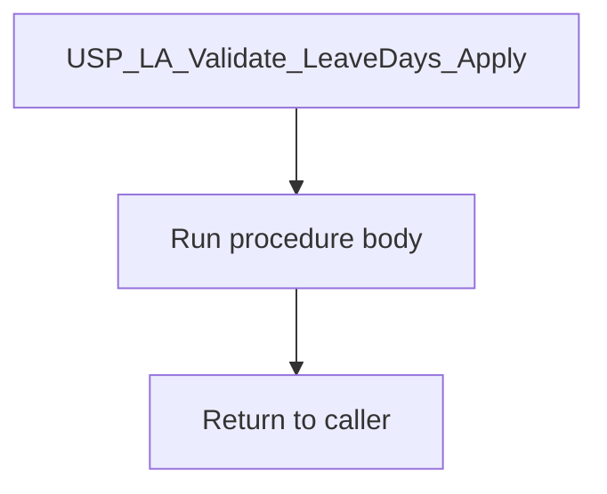

# USP_LA_Validate_LeaveDays_Apply

## What it does

Core leave day-accounting validator used during apply - sandwich/intervening day math, AR/present conflicts, and day totals.

## Parameters

| Name | Direction | What it is for |
|---|---|---|
| `@Employeeid` | in | Employee plus leave range inputs on live script |

## Call sequence

Calls no other procedures or functions.

## Callers

| Object | Kind | Page |
|---|---|---|
| `USP_LA_ValidateLeaveRequest` | procedure | [USP_LA_ValidateLeaveRequest](/docs/database/hrms/USP_LA_ValidateLeaveRequest) |

## Nested

Calls no other procedures or functions.

## Steps

1. Load leave-type intervening and prioritize-work flags.
2. Compute day counts and conflict checks.
3. Return NoOfDays and validity.

## Tables

| Table | Read or write |
|---|---|
| `TLeaveRequest / attendance / calendar` | read |

## Flow

